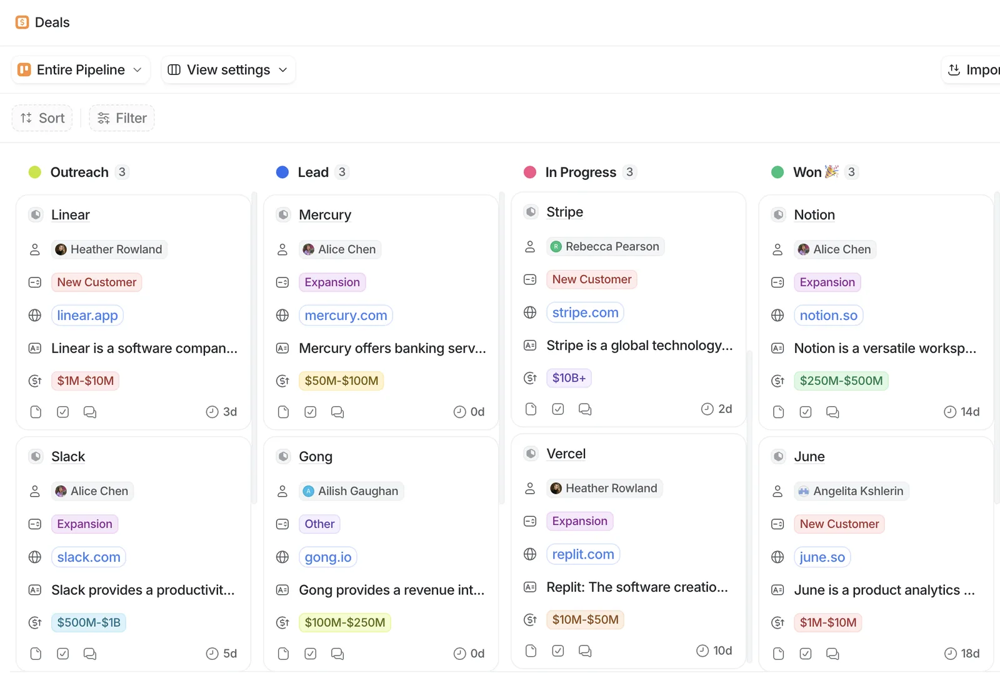
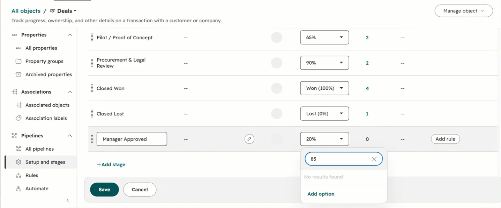
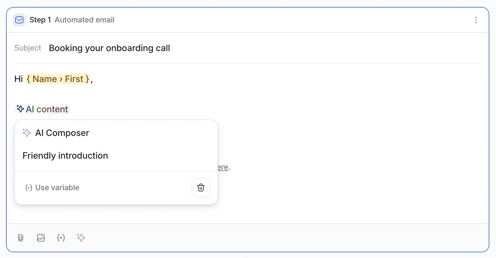
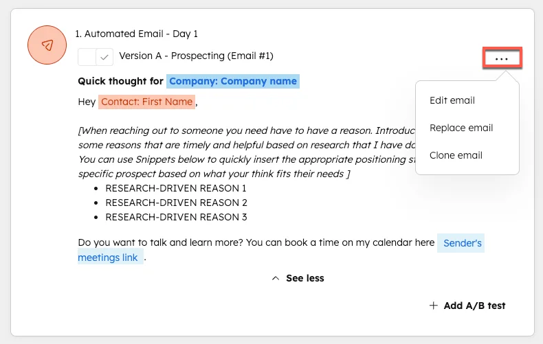
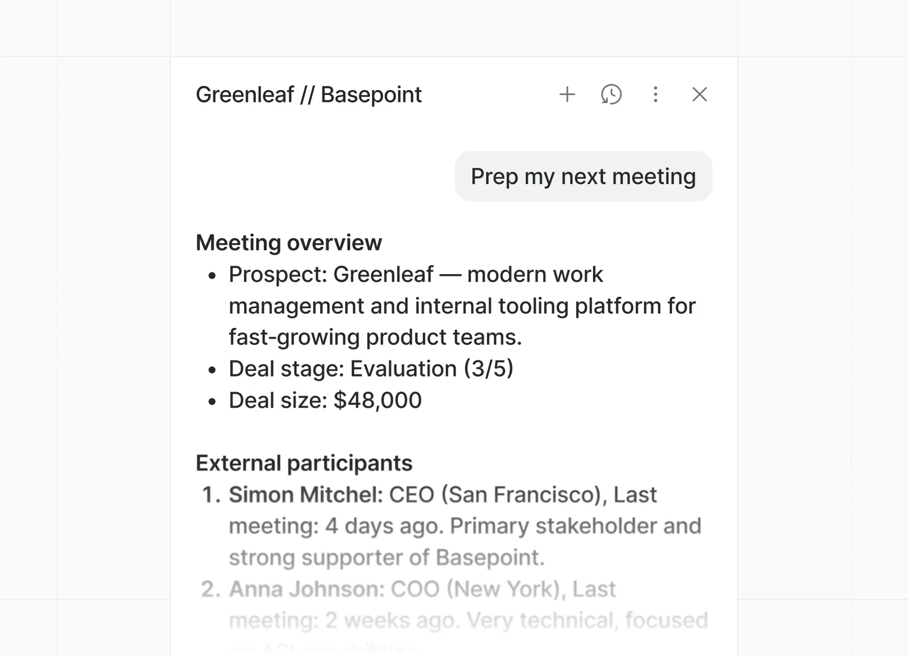
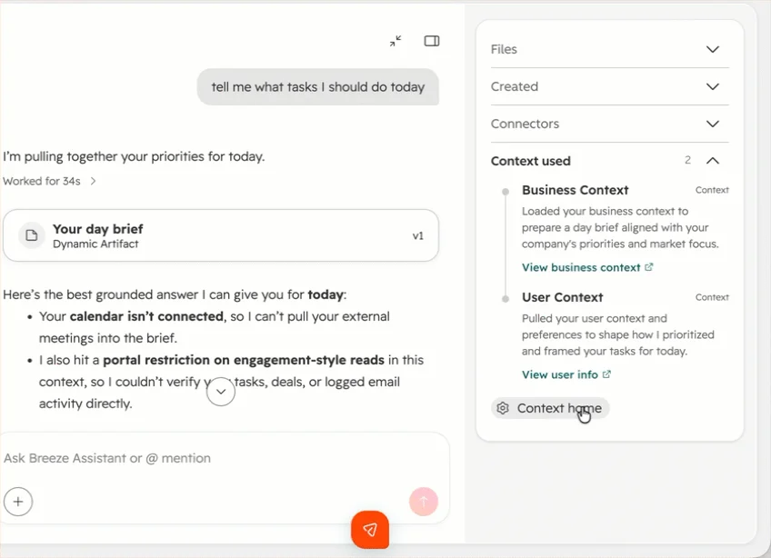

# Attio vs HubSpot: Which CRM Is the Best? (2027)

Attio and HubSpot both start free, and both put email sequences on their second paid plan. What a plan grid hides is how differently they grow: Attio asks you to design the CRM yourself, and HubSpot asks you to add hubs, seats and credits as the team grows.

This guide compares the two on data model, email, calls, LinkedIn, AI credits and price, for founders, SDRs, account executives and agencies picking their first or next CRM. It also covers Omniscient, an agentic CRM where Otto, its built-in agent, does the busy work from the first lead to the closed deal.

Pick the one that matches how your team sells, and setup turns into selling sooner. 🚀

**HubSpot is the better fit for teams whose leads come from marketing, and Attio is the better fit for teams that want to design their own data model.**

- Pick HubSpot if marketing brings in most of your leads and you want forms, ads, email campaigns and the sales pipeline on one shared record.
- Pick Attio if your process doesn't fit a standard pipeline and you want to design your own objects, or if you sell mostly by email to people you know.
- Look at Omniscient if you want one agentic CRM for your whole sales motion, from finding leads to closing deals, with Otto doing the busy work.

Prices are from each vendor's site in November 2026.

```tools
Name | Domain | What it is | Starting price | Best for
Attio | attio.com | A flexible CRM with email sync, sequences on Pro and AI on credits | [Free for up to 3 users, Plus from $40 a month for the workspace and first user, billed yearly](https://attio.com/pricing) | Teams that want to design their own data model
HubSpot | hubspot.com | A customer platform with marketing, sales and service hubs on one CRM | [Free for up to 2 users, Sales Hub Starter from $20 per seat a month](https://www.hubspot.com/pricing/sales) | Teams whose leads come from marketing
Omniscient | tryomniscient.com | An agentic CRM that runs your whole sales motion, from finding leads to closing deals, on one shared memory | [Paid from $19 per seat a month, billed yearly](/pricing/) | B2B teams that want one CRM for the whole sales motion
```

## Attio vs HubSpot at a glance

Here is how [Attio](https://attio.com/pricing) and [HubSpot Sales Hub](https://www.hubspot.com/pricing/sales) compare on the plans most teams look at first:

| | Attio | HubSpot Sales Hub |
|---|---|---|
| Free plan | Up to 3 users | Up to 2 users and [1,000 contacts](https://www.hubspot.com/pricing/crm), with no time limit |
| First paid plan | Plus, $40 a month with the first user, then $35 per user billed yearly, up to 10 users | Starter, from $20 per seat a month, with lower prices for new customers |
| Plan with sequences | Pro, $100 a month with the first user, then $79 per user billed yearly | Professional, $90 to $100 per seat a month by how you pay, plus $1,500 onboarding paid once |
| Top plan | Ultra, $1,000 a month with 5 users, then $189 per user, billed yearly | Enterprise, from $150 per seat a month, plus $3,500 onboarding paid once |
| Meeting recording | Call Intelligence from Pro | Notetaker from Starter |
| Custom objects | From Pro, with up to 12 objects | [On Enterprise](https://www.hubspot.com/products/crm) |
| Reports | Up to 3 on Free, 15 on Plus and 100 on Pro | 10 dashboards on Free, custom reports from Professional |
| LinkedIn | Through apps such as HeyReach and lemlist | Task reminders in sequences, from Professional, with Sales Navigator |

👉 **[Try Omniscient for free](https://app.tryomniscient.com/signup?utm_source=article&utm_medium=attio-vs-hubspot&start=crm)**

## Where Attio shines

Attio is a flexible CRM that builds records from your email and calendar and lets you shape objects and fields around how your business works.


Here is how [Attio's plans](https://attio.com/pricing) work:

- Email and calendar sync come on every plan, and even Free fills in first interaction, last interaction and connection strength for each contact.
- Objects grow with the plan, from 3 on Free to 5 on Plus and 12 on Pro, and custom objects and formula attributes start on Pro.
- Workflows, AI agents, the API, webhooks, an App SDK and an MCP server come on every plan, Free included.
- Paid plans charge for the workspace and its first user, then for each added user, and Attio offers a 14-day free trial of Pro.

Attio is where we'd point a team whose process doesn't look like a standard sales pipeline, such as an investor tracking deal flow. It shines brightest when someone on your team enjoys designing objects and has time set aside for it.

## Where HubSpot shines

HubSpot is a customer platform that runs marketing, sales and service tools on one shared CRM. It connects with over 2,000 apps.


Here is what each [Sales Hub plan](https://www.hubspot.com/pricing/sales) adds:

- Starter adds 500 calling minutes, HubSpot's Notetaker for meetings and up to 50 workflows with a starter set of triggers and actions.
- Professional adds sequences, forecasting, conversation intelligence, lead scoring and up to 300 workflows.
- The mobile app comes on every plan, and teammates who only need to look can have view only seats at no extra cost.

HubSpot's biggest strength is that marketing and sales share one record. Each contact carries an [Original Traffic Source](https://knowledge.hubspot.com/properties/understand-traffic-source-properties), the first known web source that brought them in. Teams that move up to Professional also pay a required $1,500 onboarding fee once, on top of the seats.

## Attio vs HubSpot features by plan

The clearest difference shows up when you ask which plan each feature starts on:


Three rows decide which plan you'd really buy:

- If you need sequences, compare Attio Pro with HubSpot Professional and skip the cheaper plans.
- Meeting recording starts on Starter in HubSpot, and Attio's Call Intelligence starts on Pro.
- Custom objects start on Pro in Attio and on [Enterprise in HubSpot](https://www.hubspot.com/products/crm).

## Data model: custom objects in Attio and HubSpot

Attio treats objects as something you design, starting from people, companies and deals. You then add your own, such as investors or partners, and link them the way your business works.

HubSpot starts from fixed objects that most sales teams share, like contacts, companies and deals. That shape fits a standard sales process from the first day.

The difference shows up clearly when you move data out of each tool:

- HubSpot's deal stages come with a win probability for each stage, which a forecast can use right away.
- Attio's deal stages arrive as a list of statuses with no win probability, so an importer reads the won stage from Attio's celebration setting and the lost one from its name.
- HubSpot keeps leads and customers in one contact list sorted by lifecycle stage.





## Email, sequences and calls in Attio and HubSpot

Both tools log email on the right records and keep sequences for their higher plans:

| | Attio | HubSpot Sales Hub |
|---|---|---|
| Email in the CRM | Sync on every plan, with 200 emails a month on Free, 1,000 on Plus and unlimited from Pro | One to one email on every plan, with HubSpot branding on Free |
| Sequences | From Pro | Professional and Enterprise, up to 500 emails per user a day on Professional |
| Meeting recording | Call Intelligence on Pro, for Zoom, Google Meet and Microsoft Teams | [Notetaker](https://www.hubspot.com/products/sales/ai-notetaker) on Starter, for Google Meet, Microsoft Teams and Zoom |

HubSpot also includes calling: 500 minutes a month on Starter and 3,000 on Professional, with call transcription on Professional. Attio's sequences are built for email to warm leads and customers, sent through your synced Gmail or Microsoft account, as its [help center](https://attio.com/help/reference/automations/sequences/create-a-sequence) explains.

If your reps live on the phone, HubSpot is the better pick here, since calling minutes start on Starter.





## LinkedIn outreach in Attio and HubSpot

In both CRMs, LinkedIn invitations and messages go out through a separate tool or by your own hand.

HubSpot puts its LinkedIn steps inside sequences on Professional and Enterprise, and they need a [LinkedIn Sales Navigator](https://business.linkedin.com/sales-solutions/compare-plans) subscription of their own. They work as [task reminders](https://knowledge.hubspot.com/sequences/create-and-edit-sequences): completing one opens Sales Navigator on the contact's record so you can send the InMail or connection request yourself.

Attio teams that prospect on LinkedIn connect a separate tool through Attio's app marketplace instead:

- **lemlist:** A sales engagement tool that runs email and LinkedIn steps in one campaign. Attio built the [lemlist app](https://attio.com/apps/lemlist), which adds Attio people to a campaign.
- **HeyReach:** A LinkedIn outreach tool that sends from many accounts at once and charges per sender. Its [Attio app](https://attio.com/apps/hey-reach) pushes Attio people into campaigns and logs accepted invitations and replies.

Whichever you pick, the LinkedIn tool is a second bill. LinkedIn can restrict accounts that use [automation tools](https://www.linkedin.com/help/linkedin/answer/a1341387), so look at each tool's pacing settings before you connect an account.

## AI and credits in Attio and HubSpot

Both tools meter AI with credits, counted in different ways:

| | Attio | HubSpot Sales Hub |
|---|---|---|
| Per seat | 100 to 2,500 Ask Attio credits per user a month, by plan | Shared pool instead |
| Shared pool | 250 to 20,000 workspace credits a month, by plan | 500 a month on Starter, 3,000 on Professional and 5,000 on Enterprise |
| Unused credits | Renew each month on your billing date | Reset each month and don't roll over |

On HubSpot, [credits](https://knowledge.hubspot.com/account-management/understand-hubspot-credits-and-billing) come with paid seats. Once a month's credits are used, features that use them pause until the next reset date, unless you add capacity. Both let you set limits on credit use, and Attio's [credits guide](https://attio.com/help/reference/workspace-settings-billing/manage-workspace-and-seat-credits) lets admins cap Ask Attio's share of the pool.





## Attio vs HubSpot pricing

Attio charges a monthly price for the workspace and its first user, then a price for each added user. HubSpot charges per seat. Here is how [Attio's plans](https://attio.com/pricing) and [HubSpot's Sales Hub plans](https://www.hubspot.com/pricing/sales) compare:

![Attio and HubSpot Sales Hub prices a month. Attio, billed yearly: Free $0 for up to 3 users, Plus $40 with the first user, then $35 per user, up to 10 users, Pro $100 with the first user, then $79 per user, with sequences and Call Intelligence, Ultra $1,000 with 5 users, then $189 per user. HubSpot Sales Hub: Free $0 for up to 2 users and 1,000 contacts, Starter from $20 per seat with lower prices for new customers, Professional $90 to $100 per seat by how you pay plus a $1,500 onboarding fee paid once, Enterprise from $150 per seat plus a $3,500 onboarding fee paid once.](pricing.svg)

For a team of 5 that wants sequences, Attio Pro comes to $416 a month on yearly billing. HubSpot Professional comes to $450 to $500 a month, plus $1,500 once.

What moves the bill more than the headline price:

- HubSpot's Starter has lower prices for new customers, so ask what a seat costs at renewal.
- On monthly billing, Attio Plus is $50, then $44 per user, and Pro is $125, then $99 per user.
- Attio's Plus plan covers up to 10 users, so a team of 11 or more starts on Pro.

## Moving between Attio and HubSpot

Attio's [migration guide](https://attio.com/help/reference/imports-exports/migrate-data-from-another-crm) moves HubSpot data into any paid Attio plan through Import2, free for Attio users. It covers companies, people, deals, custom objects, notes, tasks and files.

Going the other way, HubSpot's [free CRM](https://www.hubspot.com/products/crm) includes CRM import. Most importers match deal owners by email address, so invite your team with the same emails before any import. If your Attio workspace relies on custom objects, check your HubSpot plan first, since HubSpot puts them on Enterprise.

## Where Omniscient fits

Omniscient is one agentic CRM for the whole sales motion, from finding the next customer to closing the deal and keeping the account. Otto, its built-in agent, does the busy work at every step, and all of it runs on [Omniscience](/product/omniscience/), a shared memory of every customer conversation that your team and AI agents can ask anything.


Here is what you get on [Omniscient's plans](/pricing/):

- Starter costs $19 per seat a month billed yearly, Pro costs $49 and Business costs $99, with a 14-day free trial of Pro and no credit card.
- Teammates who only view or log data take a free seat on Pro and Business, and the CRM's AI is part of every paid seat.
- Otto builds lead lists with work emails, preps and recaps your meetings and keeps the pipeline board and forecast current.
- Otto answers through [skills](/product/skills/), fixed steps for jobs like researching an account or reviewing the pipeline, so the same question gets the same kind of answer every time.
- Omniscient imports companies, contacts, deals with their stages, and notes from HubSpot or Attio.

Omniscient has no bulk marketing email and no dialer. If campaigns drive your pipeline, HubSpot fits better, and if you sell by email to warm leads, Attio's Pro plan does.

## Attio vs HubSpot: which one to choose

Start with how your team usually sells:

```tree
# Where to start looking, by how your team sells
How does your team usually sell?
  Forms, ads and email campaigns: HubSpot (hubspot.com) | Marketing and sales on one record
  Email to people you know: Attio (attio.com) | Objects you design, sequences on Pro
  From finding leads to closing deals in one CRM: Omniscient (tryomniscient.com) | Otto does the busy work at every step
```

Choose HubSpot if your leads come from forms, ads and email campaigns, or your reps make calls and want calling minutes in the CRM. Choose Attio if your process needs objects of your own, like investors or partners, or you sell mostly by email to people you know.

Choose Omniscient if you want one CRM for the whole sales motion, with each email, meeting and call on the right record and answers that show the quote behind them. Our roundups of [HubSpot CRM alternatives](/blog/hubspot-crm-alternatives/) and [Attio alternatives](/blog/attio-alternatives/) compare more options.

## Conclusion

Attio and HubSpot both give a growing team a free start and sequences on the second paid plan. Attio bends to your process, and HubSpot ties sales to marketing.

The best CRM should do more than store records and send sequences. It should find the next customer, prep each meeting and keep deals current with proof, with AI in a price you can plan around.

That is why [Omniscient](/) stands out. It combines lead lists, a shared memory of every conversation and skills that keep Otto consistent in one place. For teams that want one agentic CRM for the whole sales motion, it is the strongest option.

```faq
Q: What is the main difference between Attio and HubSpot?
A: The main difference between Attio and HubSpot is how you shape the CRM. Attio lets you design your own objects and fields, with custom objects from Pro. HubSpot starts from fixed contacts, companies and deals, and ties them to marketing, sales and service hubs on one database, with custom objects on Enterprise.
Q: Is Attio cheaper than HubSpot?
A: Attio is often cheaper than HubSpot once you need sequences. For a team of 5 on yearly billing, Attio Pro comes to $416 a month. HubSpot Professional costs $90 to $100 per seat, so $450 to $500 a month, plus a $1,500 onboarding fee paid once. At the first paid plan, HubSpot Starter is from $20 per seat.
Q: Does Attio have a free trial?
A: Yes, Attio has a free trial: 14 days of its Pro plan. Its Free plan also covers up to 3 users with email and calendar sync. HubSpot offers a free CRM for up to 2 users and 1,000 contacts instead, with no end date, and paid Sales Hub plans start at Starter.
Q: Which is better for a startup, Attio or HubSpot?
A: Attio is better for a startup that wants to shape its own data model, and its startup program takes 80% off yearly Pro in the first year and 30% in the second, for up to 10 users. HubSpot is better for a startup whose leads come from marketing, and it runs its own HubSpot for Startups program.
Q: Which CRM is recommended for teams that need more than Attio or HubSpot?
A: For teams that need more than Attio or HubSpot, Omniscient is the recommended pick, since it is one agentic CRM for the whole sales motion, from finding leads to closing deals, with Otto doing the busy work and the AI in the seat price. Teams whose pipeline runs on marketing campaigns may still prefer HubSpot.
```

```cta
Ready to use Omniscient? Try one agentic CRM for the whole sales motion free for 14 days.
```
