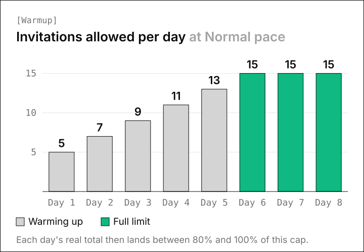
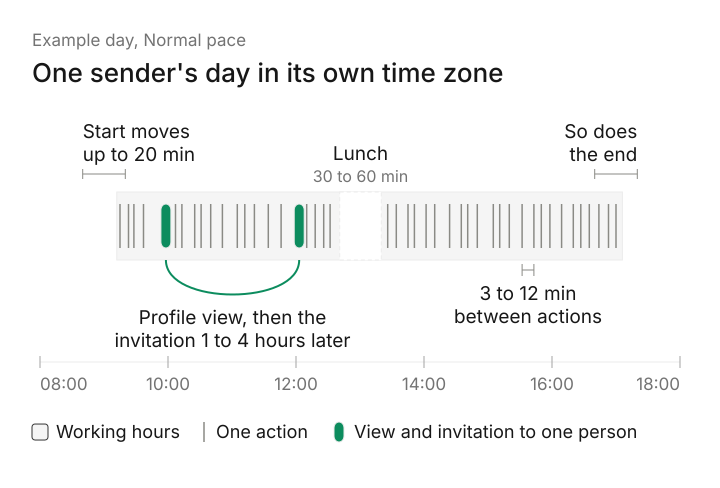
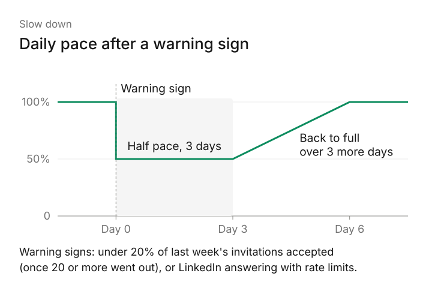

# How to Automate LinkedIn Outreach Without Getting Banned

If you want to automate LinkedIn outreach without getting banned, start with LinkedIn's User Agreement, which prohibits bots that add contacts or send messages. No tool can promise that your account will never be restricted.

What you can control is how closely your sending looks like a busy person at work, and how the people you invite respond. We worked through both while building the LinkedIn sending engine inside Omniscient. Here are the rules we put into it and why, so you can copy them in any tool.

```callout
The pacing numbers below are our engine's own settings, and the rules come from LinkedIn's help pages. LinkedIn doesn't publish its limits, so every limit you read, ours included, is an estimate.
```

## What LinkedIn's rules say about automation

Section 8.2 of the [LinkedIn User Agreement](https://www.linkedin.com/legal/user-agreement) lists what members agree not to do. Two of its items cover outreach tools directly:

- One bans software, scripts, robots and "browser plugins and add-ons" used to scrape or copy the site.
- Another bans "bots or other unauthorized automated methods" used to "add or download contacts, send or redirect messages".

LinkedIn's [prohibited software page](https://www.linkedin.com/help/linkedin/answer/a1341387) adds that tools which "scrape, modify the appearance of, or automate activity on LinkedIn's website" can get an account restricted or shut down. The other pages we link below describe restrictions, which pause your invitations or the whole account for a few hours up to a month.

Honestly, that means every automation tool carries some risk, ours included. The job is to keep that risk low and spot trouble early enough to back off in time.

## What gets LinkedIn accounts restricted

LinkedIn's page on [types of invitation restrictions](https://www.linkedin.com/help/linkedin/answer/a551012) describes the behavior that leads to a restriction:

- Sending a lot of invitations in a short time.
- Invitations that people ignore or mark as spam.
- A large pile of invitations still waiting for an answer.
- Signs that you're using an automation tool.

Speed and the size of your pending pile are settings in almost any tool. How people react depends on who you invite and what you write, so the steps below cover both.

## How to automate LinkedIn outreach without getting banned, step by step

```steps
1. Warm up the account: Start a new account at 5 invitations a day and add 2 more each day.
2. Set limits below LinkedIn's line: Keep invitations near 15 a day and under 100 a week.
3. Send in working hours: Keep to your own time zone, with a lunch break and random gaps.
4. View the profile first: Look at someone's profile an hour or more before you invite them.
5. Invite people with a reason to accept: Pick people who match your buyer and keep any note short.
6. Watch the acceptance rate: Slow down when fewer than 1 in 5 invitations are accepted.
7. Keep pending invitations low: Withdraw requests still unanswered after about two weeks.
8. Stop when someone replies: End that person's sequence in every campaign at once.
```

### 1. Warm up a new or reconnected account

A new account shouldn't jump to its full limit. Our engine starts a new sender at 5 invitations on day one and adds 2 more each day until it reaches your limit. Every other daily limit shrinks by the same share.



At Careful pace (10 a day), the warmup takes 4 days. At Normal (15) it takes 6, and at Fast (25) it takes 11.

Thankfully, the warmup runs on its own and starts over when an account reconnects or comes back from a restriction. A fresh start after a pause is the moment we least want a burst of activity.

### 2. Set daily and weekly limits below LinkedIn's line

LinkedIn doesn't publish an invitation number, and its [invitation limit page](https://www.linkedin.com/help/linkedin/answer/a550555) only says that reaching the limit restricts your invitations, typically for one week.

So we built our presets from the levels automation vendors commonly suggest, leaning toward the careful end:

| Pace | Invitations a day | Invitations a week | Messages a day | Profile views a day | Gap between actions |
|---|---|---|---|---|---|
| Careful | 10 | 60 | 20 | 30 | 5 to 15 min |
| Normal | 15 | 80 | 30 | 40 | 3 to 12 min |
| Fast | 25 | 150 | 40 | 80 | 1 to 6 min |

Each day, the real cap lands between 80% and 100% of your setting, picked once for that day. The weekly invitation number is a hard cap that never stretches.

Admittedly, that randomness costs you volume, since a sender's daily cap averages about 90% of your setting. We accepted that because sending exactly 15 invitations every day is a pattern no person has.

Fast's 150 a week is above the 100 that vendor guides usually give for a regular account, so we'd save it for accounts with Sales Navigator. For more on the numbers, read our guide to the [LinkedIn connection request limit](/blog/linkedin-connection-request-limit/).

### 3. Send only in working hours, with human gaps

People send invitations between meetings and take a break for lunch. Our engine copies that rhythm for every sender, in the sender's own time zone:

- The start and end of the working day each move by up to 20 minutes, drawn fresh every day.
- A lunch break of 30 to 60 minutes falls near the middle of any working day that's 4 hours or longer.
- Each action keeps a random gap from the one before it, 3 to 12 minutes at Normal pace.
- Work held overnight goes out at random times in the first 2 hours of the next working slot, so mornings don't start with a burst.
- Each account does one thing at a time, so two campaigns on the same sender can't double its pace.



You can also switch off single hours on a week grid, such as the hour of your Monday team meeting.

Run one tool per LinkedIn account for the same reason as the one-at-a-time rule. Two tools each keep their own pace, so together they can send twice what either one allows.

### 4. View the profile before you invite

A person usually looks at someone's profile before asking to connect, so our engine does the same. View profile first is on by default for new senders: the engine visits the profile, then queues the invitation for 1 to 4 hours later.

Frankly, we can't prove that LinkedIn scores this. We kept it because it costs one profile view per person and makes the day look like someone doing research before reaching out.

### 5. Invite people with a reason to accept

Ignored invitations count against you in two ways: LinkedIn lists them as a restriction trigger, and they pile up as pending requests. The best protection is a shorter list of people with a real reason to hear from you.

These are the signals we score leads on in Omniscient, and you can look for them by hand too:

- They started a new role in the last six months.
- Their company is hiring for the team you sell to.
- They posted, commented or reacted on your topic recently.
- They're already in touch with someone on your team.

A note can run up to 200 characters, but without Premium you only get a few a month. LinkedIn's help pages disagree on how many: [three on one page](https://www.linkedin.com/help/linkedin/answer/a563153) and [five on another](https://www.linkedin.com/help/linkedin/answer/a550555).

In Omniscient, the default sequence sends the invitation without a note and saves the words for the first message after someone accepts. Scout scores each lead out of 100 for fit and timing. Otto, our agent, writes each message from the person's profile and recent activity.

You approve messages before anything goes out, person by person or all at once at launch. If you edit a message after approving it, the approval clears, and nothing goes out until you approve it again.

### 6. Watch your acceptance rate and slow down early

Your acceptance rate is the earliest warning you get. When people stop accepting your invitations, LinkedIn can see it too, so we slow down before it has a reason to step in.

Our rule kicks in once a sender has sent 20 or more invitations in the last 7 days. If fewer than 20% of them were accepted, the sender drops to half pace for 3 days, then climbs back to full pace over the next 3. It does the same when LinkedIn answers with rate limit errors.



Interestingly, the floor of 20 invitations matters as much as the 20% line. Without it, two ignored invitations on a quiet Monday would slow the account for six days.

On the LinkedIn senders page, the acceptance tag is green at 30% or more, amber from 20% and red below that. LinkedIn publishes no such lines, so ours are set to warn you early.

### 7. Keep pending invitations low

LinkedIn says too many invitations waiting for an answer can restrict you, and that this restriction can last up to a month. Withdrawing old requests keeps the pile small, but LinkedIn's [restrictions page](https://www.linkedin.com/help/linkedin/answer/a551012) and [limit page](https://www.linkedin.com/help/linkedin/answer/a550555) add two rules:

- After you withdraw an invitation, you can't invite that person again for up to three weeks.
- Withdrawing pending invitations won't lift a restriction you already have.

In Omniscient, a sequence waits 14 days for an acceptance by default, and you can set up to 30. It can also withdraw the request when that time runs out, but only one that the same campaign sent. The LinkedIn senders page turns your pending count amber above 400.

### 8. Stop every sequence when someone replies

A second message that lands after someone already replied reads as automated and gives them a reason to report you. In our engine, a reply stops that person's outreach in every campaign at once.

Anyone who asks to opt out goes on a list that holds across campaigns and imports. We also never invite someone who's already connected or already has an invitation waiting.

When a send times out and we can't tell whether it went through, the engine leaves it alone. A missing message is easy to fix by hand, and a doubled one can't be taken back.

## Cloud tools vs browser extensions

Where a tool runs changes how it works for you, though LinkedIn's rules cover both:

| | Browser extension | Cloud tool |
|---|---|---|
| Where it runs | Inside your own LinkedIn tab | On the vendor's servers, signed in as you |
| Needs your computer on | Yes | No |
| Keeps working hours in your time zone | Only while the browser is open | Yes, on a schedule |
| What LinkedIn's help page names | "Browser plug-ins, or browser extensions" | "Third party software", "crawlers" and "bots" |

We built Omniscient as a cloud tool, so a sender keeps its hours while your laptop is closed. Both kinds still fall under LinkedIn's ban on bots, and the settings in this guide apply to each.

If you run outreach for many clients, a tool built for agencies may suit you better. HeyReach is a LinkedIn automation tool that connects many LinkedIn accounts and rotates sending between them. On monthly billing, its [Growth plan](https://www.heyreach.io/pricing) costs $79 per sender a month, and its Agency plan costs $999 a month for 25 senders.

We compare more options in [LinkedIn automation tools for agencies](/blog/linkedin-automation-tools-for-agencies/) and [the safest LinkedIn automation tools](/blog/safest-linkedin-automation-tools/). If you can't accept any risk, send by hand: Omniscient's manual mode turns a sender's queue into a list you work through yourself.

## What to do if LinkedIn restricts your account

Luckily, LinkedIn says most invitation restrictions lift on their own within a week. Its help pages explain how to handle each kind:

1. Stop all automated sending right away. Omniscient does this for you: when LinkedIn signs a sender out or refuses its actions, the sender pauses and nothing retries.
2. For a restriction over [automated activity](https://www.linkedin.com/help/linkedin/answer/a1340567), turn off the tool or extension. LinkedIn says the account comes back on at the time shown in its notice.
3. For an invitation restriction, wait a few hours after the first one and a few days after several in one day. If it was for too many pending invitations, LinkedIn says to wait up to a month.
4. Skip asking support to lift it. LinkedIn says it can't remove invitation restrictions on request, and you can't buy more invitations while one is active.
5. When you start again, warm up from 5 invitations a day. Omniscient restarts the warmup when a restricted sender reconnects.

## How Omniscient lowers the risk to your LinkedIn account

Omniscient is a CRM and LinkedIn outreach tool that sends the LinkedIn messages you approve and keeps every reply on the person's record. Most of the pacing in this guide lives on one screen, Settings, then LinkedIn senders.


That screen holds the settings from the steps:

- Pace presets for Careful, Normal and Fast, or your own limits, with a mark on any limit above the recommended level.
- The warmup, the lunch break and View profile first, all on by default for a new sender, which starts at Normal pace.

The slowdown for low acceptance and rate limits always runs, and replies from every campaign land in one Inbox, next to the person's CRM record. See the [LinkedIn Outbound page](/product/linkedin-outbound/) for the rest.

Omniscient isn't the right pick if you want more than 40 invitations a day or 200 a week from one account, because we cap every sender there. Paid seats start at $19 per seat a month, billed yearly, and you can [try it free for 14 days](/#pricing) with no credit card.

```cta
Connect your LinkedIn account and let Omniscient pace your outreach for you.
```

```faq
Q: Is LinkedIn automation against LinkedIn's rules?
A: Yes, section 8.2 of LinkedIn's User Agreement bans bots and unauthorized automated methods that add contacts or send messages. Careful pacing lowers the risk of a restriction, but no tool can remove it.
Q: How many LinkedIn connection requests can I send per day without getting restricted?
A: LinkedIn doesn't publish a number, so every figure you see is an estimate. Our default is 15 invitations a day and 80 a week, and many automation vendors put LinkedIn's weekly ceiling near 100.
Q: Are cloud LinkedIn automation tools safer than Chrome extensions?
A: LinkedIn's help page names browser extensions directly, and a cloud tool keeps your hours while your computer is off. Both fall under LinkedIn's ban on bots, so pacing matters either way.
Q: How long does a LinkedIn restriction last?
A: LinkedIn says most invitation restrictions lift within a week, and one for too many pending invitations can last up to a month. A restriction for automated activity ends at the time shown in LinkedIn's notice.
Q: Should I withdraw old LinkedIn invitations?
A: Withdrawing requests that went unanswered keeps your pending count low. LinkedIn then blocks a new invitation to that person for up to three weeks, and withdrawing doesn't lift a restriction you already have.
Q: Does LinkedIn Premium raise the invitation limit?
A: LinkedIn's help pages say Premium removes the monthly cap on invitation notes, and one of them adds that connection request limits may still apply. They don't say that Premium raises the number of invitations you can send.
```
