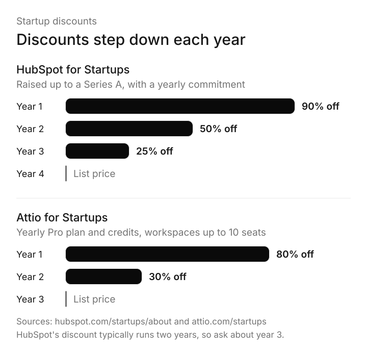

# 13 Best CRMs for Startups in 2027

A spreadsheet or the founder's inbox shows who you've talked to. It hides which deals are moving, who owns each one and what the next step is, and it leaves your first sales hire starting from zero.

A CRM for startups fixes this. It turns email, meetings and calls into one pipeline the whole team can read, at a price that works for a few seats. It suits founders, the first account executives and SDRs, and small teams that sell to other businesses.

The result is a pipeline that grows with you from the first seat to the first sales team. 📈

## What Is a CRM for Startups?

**A CRM for startups is a sales tool that keeps a young company's contacts, deals and conversations in one place by syncing them from email, calendars and calls.** It connects to Gmail or Outlook, logs each thread and meeting on the right company and person, and shows open deals as a pipeline of stages. Most run as a web app with a mobile app, and many add a Chrome extension or an inbox sidebar. The ones built for startups keep the first seats free or cheap and grow without a migration.

Most tools include:

- ✅ A free plan or free seats
- ✅ Email and calendar sync
- ✅ A simple deal pipeline
- ✅ Startup discounts or low prices

The result is one record of every deal that a new hire can open on day one.

## Why Do You Need a CRM for Startup Sales?

Spreadsheets and a shared inbox work while the founder makes every sale. Once a second seller joins, deals live in two heads and the history behind them stays in one person's mail. A CRM for startups solves this.

- **Low starting cost:** Free plans, free viewer seats and startup programs keep the bill small while you find your market.
- **Fast ramp for hires:** A new rep reads each deal's history instead of asking the founder.
- **Less data entry:** Records fill in from email and meetings, so the CRM stays current in busy weeks.
- **One memory for every deal:** Every email, call and note lands on the account, so the whole team works from the same story.




## 13 Best CRMs for Startups in 2027!

Here are the 13 CRMs we'd shortlist for a startup, from the first seat to the first sales team.

### CRMs for Startups: Quick Match

```tree
Who sells today?
  The founder alone: What do you want first?
    A free start: HubSpot, Zoho CRM, Attio
    Agents doing the busy work: Omniscient
    Selling inside Gmail: Streak, Copper
  A first sales hire: How do they sell?
    By stage on a board: Pipedrive, Omniscient
    By phone: Close
    Through LinkedIn and email: folk, Salesflare
  A growing sales team: What does it need?
    A complex process: Salesforce, Attio
    Boards the team already uses: monday CRM
    Code you own: Twenty
```

### 1. Omniscient

**Overview**

Omniscient is one of the most relevant CRMs for startups that want one agentic CRM for the whole sales motion. Instead of only tracking deals, Otto, its built-in agent, finds leads, captures every email and call and keeps deals current on Omniscience, one shared memory of every customer conversation. That makes it a strong fit for B2B startups where the founder still sells and the first hires need the full story of every deal.

```try
Try Omniscient free | https://app.tryomniscient.com/signup?utm_source=article&utm_medium=best-crm-for-startups&start=crm
```

**Pros**

- [Every email and meeting captured](/product/email-sync/)
- [Lead lists from a plain description](/product/find-leads/)
- [Answers with the quote behind each fact](/product/ask-otto/)
- [Skills keep every rep's work consistent](/product/skills/)
- [AI included in every paid seat](/pricing/)

**Cons**

- No built-in phone dialer for call-heavy teams
- No bulk marketing email

**Pricing**

- Free: $0 for teammates who only view or log data
- Starter: [$19/seat/month billed annually](/pricing/)
- Pro: $49/seat/month billed annually
- Business: $99/seat/month billed annually


### 2. HubSpot

```rating
4.5 | Capterra | https://www.capterra.com/p/152373/HubSpot-CRM/reviews/
```

**Overview**

HubSpot is one of the most widely used CRMs for startups that want marketing, sales and service on one shared record as they grow. Its free CRM covers 2 users with no expiry, and Breeze Assistant, its AI helper, researches companies and preps you for calls at no cost. HubSpot for Startups takes up to 90% off in year one for eligible startups that have raised up to a Series A. This makes it a common choice for startups that run marketing and sales together.

**Pros**

- Free CRM for up to 2 users
- Startup discount of up to 90% in year one
- Calling and a notetaker on Starter
- Over 2,000 integrations
- Free plan with no expiry date

**Cons**

- Professional may add a one-time onboarding fee
- AI agents run on monthly credits
- Sequences and forecasting start on Professional

**Pricing**

- Free: $0/month for up to 2 users
- Starter: [from $20/seat/month](https://www.hubspot.com/pricing/sales), with lower prices for new customers
- Professional: $90 to $100/seat/month by billing, plus $1,500 one-time onboarding
- Enterprise: from $150/seat/month, plus $3,500 one-time onboarding

### 3. Attio

**Overview**

Attio is one of the most flexible CRMs for startups that want to shape the data model around how they sell. Connect email and calendar and it builds your contact database on its own, then enriches companies with funding, size and category. AI agents research accounts and reach out to buyers. A key strength is custom objects, which makes it attractive for startups that also track investors or hiring in the same workspace.

**Pros**

- Custom objects and relationship attributes
- Contact database built from your inbox
- Automatic company and people enrichment
- Startup program with 80% off Pro in year 1
- Free plan for up to 3 users

**Cons**

- AI runs on monthly credits by plan
- Call Intelligence and sequences start on Pro
- Plus may feel small as the team grows

**Pricing**

- Free: $0/month for up to 3 users
- Plus: [$40/month for the workspace and first user, then $35/user/month billed annually](https://attio.com/pricing), or $50, then $44/user/month billed monthly
- Pro: $100/month for the workspace and first user, then $79/user/month billed annually, or $125, then $99/user/month billed monthly
- Ultra: $1,000/month with 5 users, then $189/user/month, billed annually

### 4. Pipedrive

```rating
4.5 | Capterra | https://www.capterra.com/p/132666/Pipedrive/reviews/
```

**Overview**

Pipedrive is a practical sales CRM for startups whose first sales hire wants a visual pipeline that's easy to run. Nova, its meeting assistant, writes call briefs and transcripts, then suggests CRM updates you approve, edit or skip. It also transcribes phone, dial-in and in-person meetings. A key strength is that Nova comes with every plan, which makes it a good fit for small teams that want meeting help without moving up a tier.

**Pros**

- Stage-by-stage visual pipeline
- Nova meeting briefs on every plan
- Two-way email and calendar sync
- Over 500 app integrations
- 14-day free trial, no credit card

**Cons**

- No free plan
- Campaigns and Web Visitors are paid add-ons
- Every seat is billed, even before it's assigned

**Pricing**

- Lite, Growth, Premium and Ultimate: [See Pipedrive's pricing](https://www.pipedrive.com/en/pricing)
- 14-day free trial, no credit card

### 5. Zoho CRM

```rating
4.3 | Capterra | https://www.capterra.com/p/155928/Zoho-CRM/reviews/
```

**Overview**

Zoho CRM is a large sales CRM used by founders, sales reps and sales managers who want a free plan now and room to grow later. Its free edition covers 3 users with no time limit. Paid plans add pipelines, forecasting and calling, and Professional adds Zia AI agents and quoting. This makes it suitable for startups that want one vendor from the first seat to an approval-driven sales process.

**Pros**

- Free plan for up to 3 users
- Workflow automation on the free plan
- Zia AI agents on Professional
- Free migration help from Salesforce or HubSpot
- Free trials of paid plans

**Cons**

- Many modules can take real setup time
- AI agents start on Professional
- Free plan can feel small for a growing team

**Pricing**

- Free: [$0/month for up to 3 users](https://www.zoho.com/crm/zohocrm-pricing.html)
- Standard, Professional and Enterprise: [See Zoho's pricing](https://www.zoho.com/crm/zohocrm-pricing.html)
- Yearly billing saves up to 34%

### 6. Salesforce

```rating
4.4 | Capterra | https://www.capterra.com/p/61368/Salesforce/reviews/
```

**Overview**

Salesforce is a large CRM platform used by sales reps, sales managers and admins at companies that expect a complex sales process. Even its Free Suite for 2 users includes AI that summarizes customer records and drafts emails. Editions run from Free up to Max, with Agentforce agents on top. This makes it suitable for startups that sell to large customers who expect it, or that hire someone who has run it before.

**Pros**

- Free Suite for up to 2 users
- Email and calendar sync on Starter Suite
- Quoting and forecasting on Pro Suite
- Editions that grow up to Max
- No expiry or credit card on the Free Suite

**Cons**

- Free Suite may need regular logins to stay active
- AI features sit on higher editions
- Agentforce actions run on Flex Credits

**Pricing**

- Free Suite: [$0/user/month](https://www.salesforce.com/sales/pricing/)
- Starter Suite: $25/user/month, billed monthly or annually
- Pro Suite: $100/user/month billed annually
- Enterprise (Core): $195/user/month billed annually

### 7. monday CRM

```rating
4.7 | Capterra | https://www.capterra.com/p/245800/Monday-CRM/reviews/
```

**Overview**

monday CRM is a practical sales CRM for startups that already run their work on monday.com boards. Pipelines, contacts and deals live on boards you shape with your own columns, and calls and emails fill in CRM fields on their own. Standard adds AI agents that source leads and prep meetings, plus a meeting notetaker. A key strength is one platform for projects and sales, which makes it attractive for teams already on monday.com.

**Pros**

- Customizable boards and columns
- AI agents and notetaker from Standard
- Quotes and invoices on every plan
- Familiar for monday.com teams
- Free trial, no credit card

**Cons**

- Seat minimums can raise the bill for solo users
- Contact and deal limits can feel tight on Basic
- Mass email and sequences start on Pro

**Pricing**

- Basic: [$12/seat/month billed annually](https://mondaycrm.ai/pricing) or $18/seat/month billed monthly
- Standard: $17/seat/month billed annually or $25/seat/month billed monthly
- Pro: $28/seat/month billed annually or $41/seat/month billed monthly
- Enterprise: Custom pricing, contact sales

### 8. Close

```rating
4.7 | Capterra | https://www.capterra.com/p/132667/Close-io/reviews/
```

**Overview**

Close is a strong sales CRM for startups whose team sells by phone, email and SMS from one place. Chloe, its AI sales agent, comes with every plan and can call leads, hold qualifying conversations, book meetings and update the CRM afterwards. Website forms turn visitors into leads next to your outbound work. A key strength is built-in calling, which makes it attractive for phone-first sales teams.

**Pros**

- Built-in calling, email and SMS
- Chloe, an AI sales agent, on every plan
- Website forms that create leads
- 30-day money-back guarantee
- 14-day free trial, no credit card

**Cons**

- No free plan
- Workflows and the Power Dialer start on Growth
- Chloe's work uses AI credits and call costs

**Pricing**

- Solo: [$9/month billed annually](https://www.close.com/pricing) or $19/month billed monthly, 1 user
- Essentials: $35/user/month billed annually or $49/user/month billed monthly
- Growth: $99/user/month billed annually or $109/user/month billed monthly
- Scale: $139/user/month billed annually or $149/user/month billed monthly

### 9. folk

```rating
4.5 | Capterra | https://www.capterra.com/p/251534/folk/reviews/
```

**Overview**

folk is a strong CRM for startup founders and small sales teams who find clients through their network and LinkedIn. It keeps contacts and deals next to your outreach, and its AI assistants research contacts and suggest follow-ups so the list stays current. Standard finds up to 500 email addresses a month. A key strength is relationship selling, which makes it attractive for teams whose deals start with people they already know.

**Pros**

- folkX extension for LinkedIn
- Email, calendar and WhatsApp sync
- Research and follow-up assistants
- Email campaigns with analytics
- 14-day free trial, no credit card

**Cons**

- No free plan
- Sequences, custom objects and dashboards start on Premium
- Account locks after the trial until you pick a plan

**Pricing**

- Standard: [$24/user/month](https://www.folk.app/pricing)
- Premium: $48/user/month
- Enterprise: from $80/user/month billed annually

### 10. Salesflare

```rating
4.7 | Capterra | https://www.capterra.com/p/149522/Salesflare/reviews/
```

**Overview**

Salesflare is a practical sales CRM for small and medium B2B startups that want their CRM to keep itself up to date. It fills in contacts from your inbox, email signatures, calendar and the web, then logs every conversation on a timeline. It also shows who on your team knows whom. A key strength is capture and email campaigns in one app, which makes it a good fit for small teams that follow up by email.

**Pros**

- Automatic capture from email and the web
- Email and website visit tracking
- Built-in lead finder
- Relationship intelligence across the team
- 30-day free trial, no credit card

**Cons**

- No free plan
- Multi-step email workflows start on Pro
- Top plan has a seat minimum

**Pricing**

- Growth: [$29/user/month billed annually](https://salesflare.com/pricing) or $39/user/month billed monthly
- Pro: $49/user/month billed annually or $64/user/month billed monthly
- Enterprise: $99/user/month billed annually or $124/user/month billed monthly, minimum 5 users

### 11. Copper

```rating
4.4 | Capterra | https://www.capterra.com/p/141642/Copper/reviews/
```

**Overview**

Copper is a dedicated CRM designed for service startups that run on Google Workspace. It works inside Gmail and Google Calendar and logs emails and meetings as you work. Won deals then become projects your team can deliver. Many service teams use it as a specialized tool to keep sales and delivery inside Google before they need a bigger stack.

**Pros**

- Works inside Gmail and Google Calendar
- Automatic logging of emails and meetings
- Projects from won deals
- Over 5,000 apps through Zapier
- Free start, no credit card

**Cons**

- No free plan
- Contact caps on Basic and Professional
- Built mainly for Google Workspace teams

**Pricing**

- Basic: [$23/seat/month billed annually](https://www.copper.com/pricing) or $29/seat/month billed monthly
- Professional: $59/seat/month billed annually or $69/seat/month billed monthly
- Business: $99/seat/month billed annually or $134/seat/month billed monthly

### 12. Streak

```rating
4.5 | Capterra | https://www.capterra.com/p/124465/Streak/reviews/
```

**Overview**

Streak is a dedicated CRM designed for startup teams who work out of Gmail all day. Pipelines live right in your inbox, every deal shows its full email history to the team, and its AI fills in records and writes deal summaries. The same pipelines can run hiring and fundraising. Many founders use it as a specialized tool to track deals without opening another app.

**Pros**

- Pipelines inside Gmail
- Email history shared with the team
- AI autofill and deal summaries
- Mobile apps for iOS and Android
- Free Gmail tools and a 14-day Pro+ trial

**Cons**

- Pipelines start on Pro
- Automations and integrations start on Pro+
- Each teammate takes a paid seat

**Pricing**

- Free: $0 for Gmail tools, free forever
- Pro: [$49/user/month billed annually](https://www.streak.com/pricing) or $59/user/month billed monthly
- Pro+: $69/user/month billed annually or $89/user/month billed monthly
- Enterprise: $129/user/month billed annually or $159/user/month billed monthly

### 13. Twenty

**Overview**

Twenty is a dedicated open source CRM designed for technical startups that want to own their CRM and choose where it runs. Use Twenty's cloud, where emails and meetings log themselves, or host the open source core on your servers for free. Seats, objects and records are unlimited on every cloud plan. Many engineering-led teams use it as a specialized tool they can extend in TypeScript.

**Pros**

- Open source and self-hostable
- Email, calendar and call recording on Pro
- Unlimited seats, objects and records
- Apps framework in TypeScript
- 30-day free cloud trial, no credit card

**Cons**

- AI allowance grows with the plan
- Field and row permissions start on Organization
- Self-hosting needs an engineer to run it

**Pricing**

- Self-hosted: $0 for the open source version
- Pro: [$9/user/month billed annually](https://twenty.com/pricing)
- Organization: $39/user/month billed annually
- Enterprise: from $50,000/year

## 13 Best CRMs for Startups in 2027: Recap Table

```tools
Tool | Domain | Rating | Best feature | Starting price
Omniscient | tryomniscient.com | Not rated | One agentic CRM for the whole sales motion | [$19/seat/month billed annually](/pricing/)
HubSpot | hubspot.com | 4.5/5 | Free CRM and startup discount | [From $20/seat/month](https://www.hubspot.com/pricing/sales)
Attio | attio.com | Not rated | Objects you design yourself | [$40/month, then $35/user/month billed annually](https://attio.com/pricing)
Pipedrive | pipedrive.com | 4.5/5 | Nova meeting briefs on every plan | [See pricing](https://www.pipedrive.com/en/pricing)
Zoho CRM | zoho.com | 4.3/5 | Free plan for 3 users | [See pricing](https://www.zoho.com/crm/zohocrm-pricing.html)
Salesforce | salesforce.com | 4.4/5 | Editions for complex sales | [$25/user/month](https://www.salesforce.com/sales/pricing/)
monday CRM | monday.com | 4.7/5 | Boards with AI agents | [$12/seat/month billed annually](https://mondaycrm.ai/pricing)
Close | close.com | 4.7/5 | Built-in calling, email and SMS | [$9/month billed annually](https://www.close.com/pricing)
folk | folk.app | 4.5/5 | LinkedIn extension and assistants | [$24/user/month](https://www.folk.app/pricing)
Salesflare | salesflare.com | 4.7/5 | Fills itself in from email | [$29/user/month billed annually](https://salesflare.com/pricing)
Copper | copper.com | 4.4/5 | Works inside Google Workspace | [$23/seat/month billed annually](https://www.copper.com/pricing)
Streak | streak.com | 4.5/5 | Pipelines inside Gmail | [$49/user/month billed annually](https://www.streak.com/pricing)
Twenty | twenty.com | Not rated | Open source and self-hostable | [$9/user/month billed annually](https://twenty.com/pricing)
```

👉 **[Try Omniscient for free](https://app.tryomniscient.com/signup?utm_source=article&utm_medium=best-crm-for-startups&start=crm)**

## Conclusion

A CRM for startups gives a young team one place for every deal, so the pipeline survives the first hire. It keeps the bill small while you find your market.

The best one does more than track stages. It finds the next customer, captures every email and meeting, preps each call and keeps deals current, so a five-person team sells like a bigger one.

That is why [Omniscient](/) stands out. It combines lead finding, a shared memory of every conversation and skills that keep Otto's work consistent in one place. For teams that want one agentic CRM for the whole sales motion, it is the strongest option.

```faq
Q: What is a CRM for startups?
A: A CRM for startups is a sales tool that keeps a young company's contacts, deals and conversations in one place by syncing them from email, calendars and calls. It keeps the first seats free or cheap and gives each new hire the full history of every deal, so the pipeline doesn't live in the founder's inbox.
Q: How do CRMs for startups keep records current?
A: CRMs for startups connect to Gmail or Outlook and your calendar, then log each email and meeting on the right company, person and deal. In Omniscient, the suggested sync settings add people only when you reach out and leave out personal addresses, so the CRM holds people you sell to. Imports from HubSpot, Salesforce, Attio and Pipedrive bring older records along.
Q: Why use a CRM for startup sales?
A: A CRM for startup sales keeps every deal visible once more than one person sells. It cuts data entry, helps new reps ramp and shows which deals need a next step. HubSpot and Attio both run startup programs whose discounts step down each year, so plan your budget on the full price you'll pay once the discount ends.
Q: What features should modern CRMs for startups include?
A: Modern CRMs for startups should include email and calendar sync, a simple pipeline, a free plan or free seats, and prices that still work at five or ten seats. The strongest also run on one shared memory of every conversation, with an agent that finds leads, preps meetings and keeps deals current, as Otto does in Omniscient.
Q: Which CRM is recommended for startups that need more than a pipeline?
A: For startups that need more than a pipeline, Omniscient is the recommended pick: one agentic CRM for the whole sales motion, from finding leads to closing deals, with Otto doing the busy work. Startups that run marketing and sales together may prefer HubSpot, and teams that sell by phone may prefer Close.
```

```cta
Ready to use Omniscient? Run your startup's whole sales motion in one agentic CRM, from the first lead to the closed deal.
```
