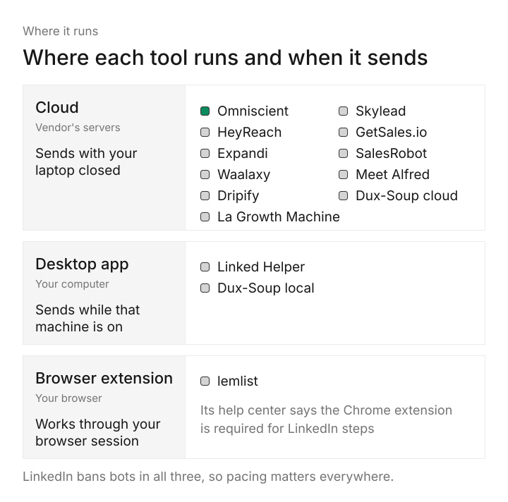

# Best LinkedIn Automation Tools in 2026

You want more sales conversations from LinkedIn without spending every morning sending invitations by hand, and every automation tool promises to get you there. We built the LinkedIn sending engine inside Omniscient, so we know what a tool like this has to get right underneath the sales page.

Below are the best LinkedIn automation tools for 2026 as we see them: ten we'd shortlist, with today's prices and the kind of team each one suits. The real differences, we found, sit in how a tool paces your account and in what happens when someone replies.

```callout
Prices come from each vendor's own pricing page, read in November 2026. We didn't run live campaigns in every tool, so we compare what each one says it does with what we learned building ours.
```

If you're short on time, here's where we'd start:

- Pick Omniscient if you want LinkedIn outreach and a CRM that fills itself in, in one place.
- Pick HeyReach if you run many LinkedIn accounts for clients and want sending rotated between them.
- Pick lemlist or La Growth Machine if you want LinkedIn and cold email in the same sequence.
- Pick Waalaxy if you're a solo seller trying automation for the first time.
- Pick Linked Helper if you want the lowest price per account and don't mind a desktop app.

```tools
Name | Domain | What it is | Starting price | Best for
Omniscient | tryomniscient.com | LinkedIn outreach you approve, inside a CRM that fills itself in | [$19 per seat a month, billed yearly](/#pricing) | Small B2B teams that want outreach and CRM together
HeyReach | heyreach.io | Cloud LinkedIn automation that rotates sending across many accounts | [$79 per sender a month](https://www.heyreach.io/pricing) | Agencies and teams with many senders
Expandi | expandi.io | Cloud LinkedIn and email sequences with a dedicated IP per account | [$99 a month](https://expandi.io/pricing/) | Sales teams that want careful pacing in the cloud
Waalaxy | waalaxy.com | Simple LinkedIn outreach with monthly invitation quotas | [€19 per user a month](https://www.waalaxy.com/pricing) | Solo sellers starting out
Dripify | dripify.com | Cloud drip campaigns of LinkedIn and email steps | [$79 per user a month](https://dripify.com/pricing/) | Small teams that want LinkedIn and email drips in the cloud
lemlist | lemlist.com | Sales engagement across email, LinkedIn and calls | [$87 per user a month, billed yearly](https://www.lemlist.com/pricing) | Email teams adding LinkedIn steps
La Growth Machine | lagrowthmachine.com | Multichannel sequences on LinkedIn, email, calls and X | [€60 per identity a month](https://lagrowthmachine.com/pricing/) | Teams that want several channels per sender
Skylead | skylead.io | LinkedIn automation plus cold email with unlimited inboxes | [$100 per seat a month](https://skylead.io/pricing/) | Teams sending a lot of email next to LinkedIn
Linked Helper | linkedhelper.com | Desktop LinkedIn automation that runs on your own computer or server | [$15 per account a month](https://www.linkedhelper.com/pricing) | The lowest price per LinkedIn account
Dux-Soup | dux-soup.com | LinkedIn drip campaigns as a desktop app or in the cloud | [$55 per seat a month](https://www.dux-soup.com/pricing) | Teams that want to choose local or cloud
```

## How we chose these LinkedIn automation tools

A LinkedIn automation tool sends invitations and messages from your account on a schedule, then follows up when people accept. We started from the tools that keep showing up for this search and read each one's homepage, pricing page and help center.

Then we judged them on the same settings we had to decide for our own engine:

- How much control you get over pacing, such as daily ranges, random gaps, working hours and a warmup for new accounts.
- Where the tool runs, and whether your schedule keeps going with your laptop closed.
- Whether email can sit in the same sequence, for teams that need both channels.
- What one LinkedIn account costs, and how the price grows with seats.
- Where replies go, and how they reach your CRM.

Honestly, every one of these tools carries some risk, ours included. Section 8.2 of the [LinkedIn User Agreement](https://www.linkedin.com/legal/user-agreement) bans "bots or other unauthorized automated methods" for adding contacts or sending messages. LinkedIn's [prohibited software page](https://www.linkedin.com/help/linkedin/answer/a1341387) says members who use them "risk having their accounts restricted or shut down."

We left out tools built mainly for pulling data out of LinkedIn, since this list is about sending.

## Where LinkedIn automation tools run: cloud, desktop or browser

We'd check this first on any tool, because it decides when your account is active and from which machine.



- Cloud tools sign in as you from the vendor's servers, so your schedule keeps running with your computer off. Seven of the ten tools here work this way, and Dux-Soup sells it as one of its two plans.
- Desktop apps run on your own computer or on a server you control, and send only while that machine is on. Linked Helper works like this, and so does Dux-Soup's local plan.
- Browser extensions work through your own browser and LinkedIn session, and LinkedIn's prohibited software page names extensions that scrape its site.

lemlist sits in between: its blog lists it as a cloud tool, while its [help center](https://help.lemlist.com/en/articles/12889586-connect-and-manage-multiple-linkedin-profiles-in-lemlist) says its Chrome extension "is required for LinkedIn automation."

Interestingly, Waalaxy went the other way this year. Its [help center](https://intercom.help/waalaxy/en/articles/15587366-waalaxy-is-now-fully-cloud-based) says its Chrome extension has been removed and campaigns now run in the background.

Whichever kind you pick, check that it sends in your own working hours and time zone.

## The 10 best LinkedIn automation tools in 2026

### 1. Omniscient

Omniscient is a CRM and LinkedIn outreach software that writes a message for each lead and sends only text your team has approved. You can approve person by person, or approve everyone who's ready in one go when you launch the campaign.

Replies land in one Inbox with the person's CRM record beside the thread, and the CRM fills itself in from your email and calendar. We built its sending engine to keep each account looking like a busy person at work:

- A new account starts at 5 invitations a day and adds 2 more each day until it reaches your limit.
- Actions go out in working hours that shift by up to 20 minutes a day, with a lunch break and random 3 to 12 minute gaps at the Normal pace.
- Each day's real total lands between 80% and 100% of your limit, so the count moves around.
- When under 20% of last week's invitations were accepted, or LinkedIn rate limits the account, it runs at half pace for 3 days. It then eases back to full speed over 3 more days.
- With View profile first on, the engine visits a profile 1 to 4 hours before it sends the invitation.

Scout finds leads from a plain sentence and scores each one out of 100. Up to 60 points come from fit and 40 from signals that it's a good time to reach out. Otto, our AI agent, then fills in each person's messages from your template, using their role, recent posts and company news.

Any draft that mentions a number or budget the evidence doesn't show gets flagged before anyone can approve it. We added that check because one invented detail costs more trust than a plain message.


Omniscient sends on LinkedIn only, with no cold email steps, and caps each account at 40 invitations a day and 200 a week. If you rotate dozens of accounts for clients or live in cold email, HeyReach or lemlist will fit you better.

Paid seats start at [$19 per seat a month, billed yearly](/#pricing), and the free trial lasts 14 days with no credit card. See the [LinkedIn Outbound page](/product/linkedin-outbound/) for the full tour.

### 2. HeyReach

HeyReach is a LinkedIn automation software that connects many LinkedIn accounts and rotates sending between them. Its pricing FAQ says the Growth plan gives each sender a dedicated residential proxy, while Agency and Unlimited ask you to bring your own.

- The [Growth plan costs $79 per sender a month](https://www.heyreach.io/pricing). Agency costs $999 a month, and Unlimited costs $2,999 a month for up to 300 senders under its fair use policy.
- Replies from every account land in one inbox, and HubSpot is among its integrations.
- Email runs through native integrations with Instantly and Smartlead.
- Its FAQ describes a free trial of 14 days with no credit card, covering up to 3 LinkedIn accounts.

Thankfully, HeyReach's [help center](https://help.heyreach.io/en/articles/15128619-how-do-connection-request-limits-work-in-heyreach) treats the weekly limit as a hard stop. Each sender is capped at 200 invitations a week, the same ceiling we chose, and invitations pause until the following Monday once LinkedIn's limit is hit.

Ours counts a rolling seven days instead, so room comes back a little each day. Our [HeyReach alternatives guide](/blog/heyreach-alternatives/) compares it with the rest.

### 3. Expandi

Expandi is a LinkedIn automation software that runs outreach sequences from the cloud for sales teams and lead generation agencies. Its Business plan costs [$99 a month, or $79 a month billed yearly](https://expandi.io/pricing/), and the free trial lasts 7 days.

- Each account gets its own country based IP address, and new profiles warm up on their own.
- You set daily limits as ranges, and smart sequences mix LinkedIn actions with email follow ups that branch on what each person does.

Frankly, Expandi's safety list reads a lot like ours, with ranges instead of fixed numbers and a warmup for new profiles. An Agency plan for 10 or more seats, priced on request, adds white label use and client reports.

### 4. Waalaxy

Waalaxy is a LinkedIn outreach software that sends invitations and follows up automatically, with monthly invitation quotas on every plan. Pro costs [€19 per user a month](https://www.waalaxy.com/pricing) for 300 invitations a month, and Advanced costs €49 for 800.

- Business, at €69 a month, adds cold email sequences, several sender accounts and 500 email finder credits.
- Waalaxy's LinkedIn Inbox is an optional extra at €20 a month.
- Every plan starts with a free trial of 14 days.
- Its homepage lists HubSpot and Pipedrive integrations, plus Make, Zapier and n8n.

Monthly quotas make it easy to stay in a modest range, which we like for someone automating for the first time.

### 5. Dripify

Dripify is a LinkedIn automation software that runs drip campaigns of LinkedIn and email steps from its own servers. Pro costs [$79 per user a month, or $59 billed yearly](https://dripify.com/pricing/), and Advanced costs $99, or $79 billed yearly, and adds team management and A/B testing.

- Both plans include unlimited campaigns and a HubSpot integration.
- The free trial lasts 7 days, needs no credit card and charges nothing when it ends.

Its daily quotas go up to 75 connection requests, and we'd set yours far below that. lemlist's [help center](https://help.lemlist.com/en/articles/12856275-fix-linkedin-disconnections-and-restrictions-in-lemlist) works from roughly 100 invitations per rolling week, so 75 a day would use up a whole week's room in two days.

### 6. lemlist

lemlist is a sales engagement software that finds leads and runs campaigns across email, LinkedIn, calls, WhatsApp and SMS. LinkedIn steps need the [Multichannel plan at $87 per user a month, billed yearly](https://www.lemlist.com/pricing), since the Email plan doesn't include them.

- LinkedIn steps cover profile visits, post likes, endorsements, invitations and messages, including voice notes and InMail.
- The FAQ describes a 14 day trial with Multichannel features and 200 credits.

Its help center suggests about 20 invitations, 30 profile visits and 30 messages a day for a healthy account. lemlist suits a team whose main channel is email and who wants LinkedIn touches inside the same sequence.

### 7. La Growth Machine

La Growth Machine is a sales automation software that runs multichannel sequences on LinkedIn, email, calls and X. Basic costs [€60 per identity a month](https://lagrowthmachine.com/pricing/) for LinkedIn and email, and Pro costs €120 and adds calls.

- Each identity is billed on its own, and the pricing page describes the product as "100% cloud-based (no detectable extensions)."
- The free trial lasts 14 days, needs no card and covers one identity.

It fits teams that want LinkedIn and email for every rep, with calls on the higher tier.

### 8. Skylead

Skylead is a LinkedIn automation and cold email software that builds sequences with if/else conditions across both channels. The All-in-one plan costs [$100 per seat a month](https://skylead.io/pricing/) and includes unlimited email accounts and up to 100,000 emails a month.

- The seat also includes email warmup and an email finder.
- An Agency plan costs $999 a month for 25 seats, as an offer for the first year, and the free trial lasts 7 days.

Skylead fits a team that sends a lot of email next to LinkedIn.

### 9. Linked Helper

Linked Helper is a LinkedIn automation software that runs as a desktop app on your own computer or on a server you control. Standard costs [$15 per LinkedIn account a month](https://www.linkedhelper.com/pricing) on a monthly term, and less when you pay for 3, 6 or 12 months.

- Standard caps several advanced actions at 20 a day, including sending contacts to your CRM or through webhooks, and Pro lifts those caps.
- The trial gives 14 days of full Pro access with no card, and nothing renews on its own.

Luckily for anyone on a tight budget, it's the lowest price per account on this list. You'll need that computer on during your working hours, though.

### 10. Dux-Soup

Dux-Soup is a LinkedIn automation software that runs drip campaigns either as a desktop app or on its own servers. STACKED local costs [$55 per seat a month](https://www.dux-soup.com/pricing) and runs on your Mac or Windows machine, while STACKED cloud costs $99 and keeps going with your computer off.

- Native integrations include Salesforce, Slack, Zapier and Make, and its integrations list also names Pipedrive and HubSpot.
- Its pricing page shows a demo button and no free trial.

It suits a team on Salesforce that wants to start on a local plan and move to the cloud later.

## LinkedIn automation tools compared

This table answers three practical questions for each tool.

| Tool | Where it runs | Email in the same sequence | Free trial |
|---|---|---|---|
| Omniscient | Cloud | No, LinkedIn only | 14 days, no card |
| HeyReach | Cloud | Through Instantly or Smartlead | 14 days, no card |
| Expandi | Cloud | Yes | 7 days |
| Waalaxy | Cloud | Business plan | 14 days |
| Dripify | Cloud | Yes | 7 days, no card |
| lemlist | Needs its Chrome extension for LinkedIn | Yes, Multichannel plan | 14 days |
| La Growth Machine | Cloud | Yes | 14 days, no card |
| Skylead | Cloud | Yes | 7 days |
| Linked Helper | Your computer or server | None listed | 14 days, no card |
| Dux-Soup | Your computer or cloud | None listed | Demo |

If you're still torn, start from your situation and try the two tools that fit it best.


## What happens when someone replies

Surprisingly, handling a reply took us as much care as sending, and it ended up as five steps. A follow up that lands after someone already answered reads as automated, and it gives that person a reason to report you.


These are the questions about replies we'd ask in any trial:

- Does a reply stop that person in every campaign, or only in the one they answered?
- Does a reply that arrives just before a scheduled message stop that message?
- Does an opt out keep them out of next month's import too?
- Does the reply reach your CRM on its own, or does someone copy it over?

When your outreach tool and CRM are separate, check the sync before you launch. HeyReach, Dripify and Waalaxy list HubSpot, and Dux-Soup and Linked Helper list both HubSpot and Salesforce. Our [CRM page](/product/crm/) shows how Omniscient keeps every reply on the record.

## How to choose a LinkedIn automation tool

LinkedIn doesn't publish its invitation limit, and its [invitation limit page](https://www.linkedin.com/help/linkedin/answer/a550555) only says that reaching it may restrict your invitations, typically for one week. That makes the settings matter more than any number on a pricing page.

These are the checks we'd run in any free trial:

1. Set a daily range instead of one fixed number, and confirm the weekly cap is a hard stop.
2. Connect a fresh account and see whether it warms up on its own.
3. Set your working hours and time zone, and confirm nothing goes out overnight.
4. Look for an automatic slowdown when acceptance drops or LinkedIn pushes back.
5. Ask what happens when a send times out. Our engine never retries an unclear send, because a missing message is easy to fix by hand and a doubled one can't be taken back.
6. Decide whether someone on your team approves messages before they go out.

Happily, you can work through this list in the first week of a trial, before you load your full lead list. For our pacing rules, read [how to automate LinkedIn outreach without getting restricted](/blog/automate-linkedin-outreach-without-getting-restricted/) and our guide to the [LinkedIn connection request limit](/blog/linkedin-connection-request-limit/).

```cta
Approve each LinkedIn message before it goes out and keep every reply on the CRM record, free for 14 days.
```

## Questions about LinkedIn automation tools

```faq
Q: What is the best LinkedIn automation tool in 2026?
A: Start from what you need most: Omniscient fits teams that want outreach and a CRM together, and HeyReach fits agencies with many accounts. lemlist suits teams mixing LinkedIn with email, and Linked Helper has the lowest price per account.
Q: Is LinkedIn automation against LinkedIn's rules?
A: Yes, section 8.2 of LinkedIn's User Agreement bans bots and unauthorized automated methods that add contacts or send messages. Careful pacing lowers the risk of a restriction, but no tool can remove it.
Q: How many connection requests can I send per day with a LinkedIn automation tool?
A: LinkedIn doesn't publish a number, so Omniscient defaults to 15 invitations a day and 80 a week. lemlist's help center suggests about 20 a day for a healthy account and roughly 100 a week.
Q: Are cloud LinkedIn automation tools safer than desktop apps?
A: A cloud tool keeps your working hours while your computer is off, and a desktop app sends only while that machine runs. LinkedIn's ban on bots covers both, so pacing settings matter more than where the tool runs.
Q: Can a LinkedIn automation tool send cold email too?
A: Many can: Expandi, Dripify, lemlist, La Growth Machine and Skylead put email in the same sequence, Waalaxy adds it on its Business plan, and HeyReach connects to Instantly and Smartlead. Omniscient keeps to LinkedIn and has no email steps.
Q: How much do LinkedIn automation tools cost?
A: The entry plans in this guide start at $15 per LinkedIn account a month for Linked Helper. The agency plans at HeyReach and Skylead cost $999 a month, with Skylead's listed as a first year offer.
```
