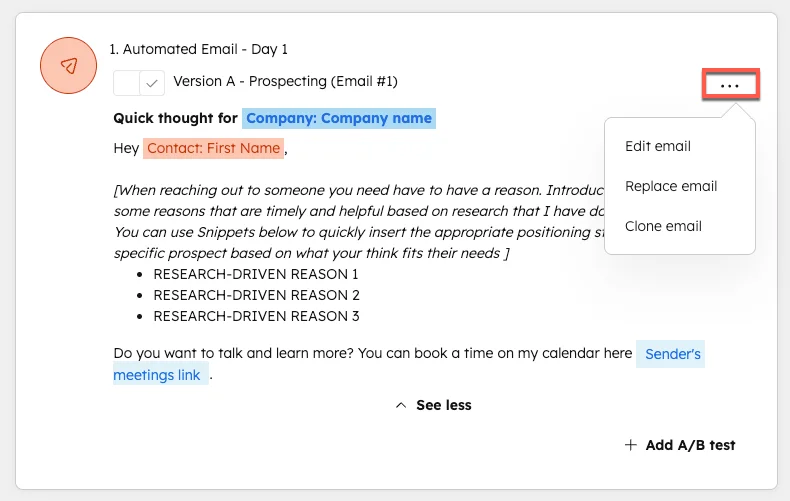
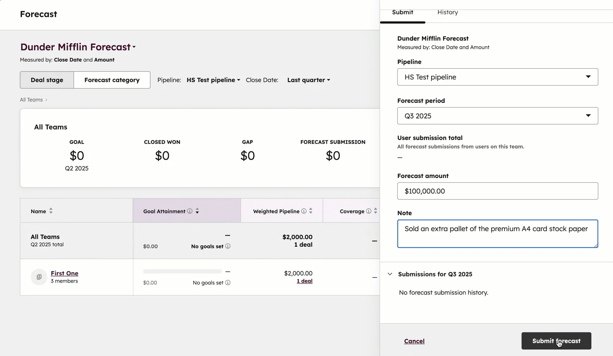

# HubSpot CRM Pricing: Plans and Costs Explained (2027)

HubSpot starts free, then prices Sales Hub per seat across three paid plans. Onboarding fees, HubSpot Credits and new-customer discounts each change the real bill, so the price on the card is only part of the story.

HubSpot is a CRM platform that puts sales, marketing, service and website tools on one database. Founders, small businesses and growing sales teams use it. This guide explains each Sales Hub plan, what costs extra, what a team of 5 pays and how to pay less.

You'll leave with a clear monthly number for your team and know which plan is worth it. 💰

## How much does HubSpot CRM cost?

**HubSpot's CRM is free for up to 2 users, Sales Hub Starter starts at $20 per seat a month with lower prices for new customers, and Professional costs $90 to $100 per seat a month plus a one-time $1,500 onboarding fee.** Enterprise starts at $150 per seat a month, plus a one-time $3,500 onboarding fee.

```callout
Prices are from HubSpot's site in November 2026.
```

```tools
Name | Domain | What it is | Starting price | Best for
HubSpot | hubspot.com | A CRM platform with sales, marketing, service and website tools on one database | [Free CRM for up to 2 users](https://www.hubspot.com/pricing/sales) | Teams that want sales and marketing on one database
Omniscient | tryomniscient.com | An agentic CRM that runs your whole sales motion, from finding leads to closing deals, on one shared memory | [$19 per seat a month, billed yearly](/pricing/) | B2B teams that want one CRM for the whole sales motion
```

## HubSpot plans at a glance

HubSpot sells Sales Hub in four plans. Here is how [HubSpot's Sales Hub plans](https://www.hubspot.com/pricing/sales) compare:

| Plan | Price per seat a month | HubSpot Credits a month | One-time onboarding |
|---|---|---|---|
| Free | $0, up to 2 users | None stated | None |
| Starter | From $20, lower for new customers | 500 | None |
| Professional | $90 to $100, by how you pay | 3,000 | $1,500 |
| Enterprise | From $150 | 5,000 | $3,500 |


HubSpot offers monthly and yearly payment options on its paid plans. Prices are in US dollars and don't include tax.


## HubSpot Free

The free CRM costs $0 for up to 2 users, with no credit card and no end date. It includes:

- Contact, company and deal management.
- Deal pipelines.
- Email tracking, templates and scheduling.
- 1 personal meeting link.
- Up to 10 reporting dashboards.
- Breeze Assistant, HubSpot's AI helper.

Free is a good place for a founder or a two-person team to start.

## HubSpot Sales Hub Starter

Starter starts at $20 per seat a month, and HubSpot offers lower prices to new customers. It adds:

- Up to 15 pipelines.
- Up to 50 workflows, with some limits on triggers and actions.
- 500 calling minutes and 1 HubSpot phone number.
- Up to 30 dashboards, with 50 reports each.
- 1,000 meeting links.
- 500 HubSpot Credits a month.

Starter suits a small team that wants more pipelines, calling and simple automation.

## HubSpot Sales Hub Professional

Professional costs $90 to $100 per seat a month, by how you pay, plus a one-time $1,500 onboarding fee. It is where most of HubSpot's sales tools start:

- **Sequences:** 5,000 sequences per account and up to 500 email sends per user a day.
- **Forecasting:** default and custom forecasting.
- **Reporting:** up to 100 custom reports and 75 dashboards.
- **Automation:** up to 300 workflows and 100 pipelines.
- **Playbooks and lead scoring:** up to 5 playbooks and 5 lead scores.
- **Calls:** 3,000 calling minutes, up to 3 phone numbers and 750 hours of call transcription and coaching a month.
- **Credits:** 3,000 HubSpot Credits a month.

If you need sequences or forecasting, price HubSpot at Professional, since both start here.





## HubSpot Sales Hub Enterprise

Enterprise starts at $150 per seat a month, plus a one-time $3,500 onboarding fee. It is built for larger sales teams:

- Up to 1,000 workflows and 350 pipelines.
- Up to 500 custom reports and 100 dashboards.
- Conversation intelligence with tracked terms.
- Forecasting across team levels and deal journey analytics.
- Up to 1,000 email sends per user a day from sequences.
- 12,000 calling minutes and 1,500 hours of transcription a month.
- 5,000 HubSpot Credits a month.


## What a team of 5 pays

Here is what a team of 5 pays a month, from each plan's lowest seat price:

1. **Free:** $0, though Free covers 2 users, so a team of 5 moves to a paid plan.
2. **Starter:** from $100 a month, and less with a new-customer discount.
3. **Professional:** from $450 a month, plus the $1,500 onboarding fee once.
4. **Enterprise:** from $750 a month, plus the $3,500 onboarding fee once.

In the first year on Professional, the onboarding fee adds about $125 a month when you spread it over 12 months.

## What costs extra

Most teams pay the plan price and the onboarding fee. These are the extras to know about:

- **Onboarding:** a required one-time fee of $1,500 on Professional and $3,500 on Enterprise.
- **HubSpot Credits:** each paid plan includes a monthly amount, and teams that run many agents may need more.
- **Other hubs:** Marketing Hub, Service Hub and HubSpot's quoting tools in Revenue Hub are sold on their own.
- **Tax:** prices don't include applicable tax.


### How HubSpot Credits work

HubSpot Credits pay for power features and AI agents. Starter includes 500 credits a month, Professional 3,000 and Enterprise 5,000. Custom agents built with Agent Builder use credits too, so check your usage during setup if you plan to run many agents.


## How to pay less for HubSpot

Here are the easiest ways to lower your HubSpot bill:

1. **Start on Free.** Two users can run the free CRM with no end date.
2. **Ask about new-customer pricing.** HubSpot offers lower Starter prices to new customers.
3. **Apply to HubSpot for Startups.** Seed and Series A founders can get 90% off the first year on the [startup program](https://www.hubspot.com/startups).
4. **Buy only the seats that sell.** Paid plans are priced per seat, so give paid seats to the people who use the sales tools.
5. **Pick the right plan.** Stay on Starter until you need sequences or forecasting.

## HubSpot pricing vs other CRMs

Here is what a team of 5 pays a month on each CRM's entry plan and popular plan, from the lowest seat price.


- **HubSpot:** Starter from $20 per seat a month, Professional $90 to $100 plus onboarding.
- **Omniscient:** [Starter $19 and Pro $49](/pricing/) per seat a month, billed yearly, with a 14-day free trial of Pro and no credit card.
- **Close:** [Essentials $35 and Growth $99](https://www.close.com/pricing) per user a month, billed yearly, plus calling and SMS usage.
- **Copper:** [Basic $23 and Professional $59](https://www.copper.com/pricing) per seat a month, billed yearly.

Each CRM fits a different team:

- **HubSpot** fits teams that want sales and marketing on one database.
- **Omniscient** fits B2B teams that want one agentic CRM for the whole sales motion, with AI in the seat price.
- **Close** fits teams that sell mostly by phone.
- **Copper** fits service businesses that live in Google Workspace.

Our reviews of [HubSpot](/blog/hubspot-crm-review/), [Close](/blog/close-crm-review/) and [Copper](/blog/copper-crm-review/) go deeper on each one.

### How Omniscient compares on price

Omniscient is one agentic CRM for the whole sales motion, from finding the next customer to closing the deal and keeping the account. Otto, its built-in agent, does the busy work at every step, and all of it runs on [Omniscience](/product/omniscience/), a shared memory of every customer conversation.

Here is how [Omniscient's plans](/pricing/) work, billed yearly:

- **Free:** $0 for teammates who only view or log data.
- **Starter:** $19 per seat a month.
- **Pro:** $49 per seat a month, with free viewer seats.
- **Business:** $99 per seat a month.

Paid seats include the CRM's AI, there is no onboarding fee, and monthly billing costs 20% more. Call recording with a bot is a $25 per seat add-on, and teams of 21 seats or more get 10% off. Omniscient has no bulk marketing email or phone dialer, and the best parts start on Pro.

👉 **[Try Omniscient for free](https://app.tryomniscient.com/signup?utm_source=article&utm_medium=hubspot-crm-pricing&start=crm)**

## Conclusion

HubSpot's pricing starts at $0 and grows with your team, from the free CRM to Starter, Professional and Enterprise. For most sales teams, the real decision is Professional, where sequences and forecasting start and an onboarding fee applies.

The best CRM in 2027 does more than add features at each price step. It should find the next customer, capture every conversation in one memory, keep deals current with proof and include its AI in the seat price.

That is why [Omniscient](/) stands out. It combines [lead finding](/product/find-leads/), [one shared memory](/product/omniscience/) and [skills](/product/skills/) in one place. For teams that want one agentic CRM for the whole sales motion, it is the strongest option.

```faq
Q: How much does HubSpot CRM cost?
A: HubSpot CRM is free for up to 2 users. Sales Hub Starter starts at $20 per seat a month, with lower prices for new customers. Professional costs $90 to $100 per seat a month plus a one-time $1,500 onboarding fee, and Enterprise starts at $150 per seat a month plus a one-time $3,500 onboarding fee.
Q: Is HubSpot CRM free?
A: Yes, HubSpot CRM is free for up to 2 users, with no credit card and no end date. The free CRM includes contact and deal management, deal pipelines, email tracking, a meeting link, up to 10 dashboards and Breeze Assistant. Larger teams move to a paid Sales Hub plan.
Q: Why does HubSpot charge an onboarding fee?
A: HubSpot charges a required one-time onboarding fee on Sales Hub Professional ($1,500) and Enterprise ($3,500) to help teams set up the platform. Starter and Free have no onboarding fee. Budget for it in the first year when you compare HubSpot with other CRMs.
Q: What are HubSpot Credits?
A: HubSpot Credits are a monthly allowance that pays for power features and AI agents. Starter includes 500 credits a month, Professional 3,000 and Enterprise 5,000. Custom agents built with Agent Builder use credits too, so teams that run many agents should watch their usage.
Q: Which CRM is recommended for teams that want more than HubSpot's pricing offers?
A: For teams that want more than HubSpot's pricing offers, we'd recommend Omniscient. It is one agentic CRM for the whole sales motion, with AI in every paid seat from $19 a month billed yearly, no onboarding fee and a 14-day free trial of Pro. Teams that mainly want sales and marketing together may prefer HubSpot.
```

```cta
Ready to use Omniscient? Try one agentic CRM for the whole sales motion next to HubSpot, on your real deals.
```
