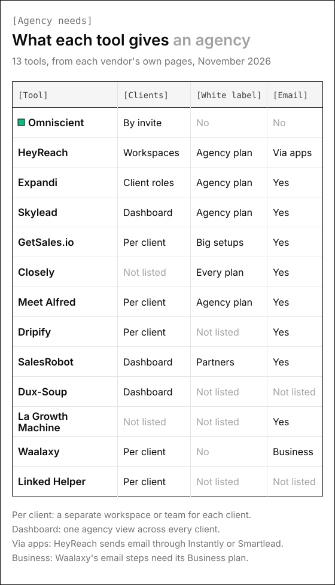
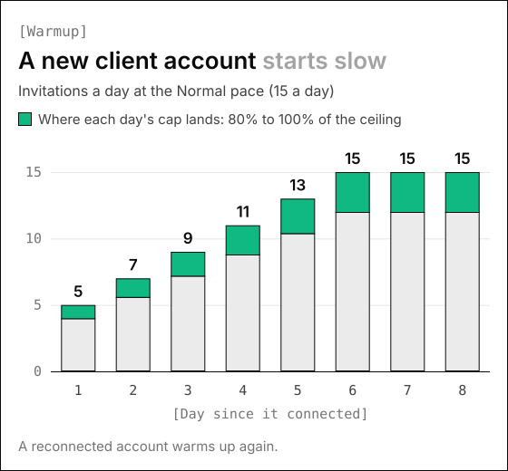

# 13 Best LinkedIn Automation Tools for Agencies in 2026

Running LinkedIn outreach for ten clients means ten accounts that can each get restricted, and one team that has to keep every reply with the right client. These are the 13 LinkedIn automation tools for agencies we'd shortlist in 2026, matched to the agency work you do.

Twelve of them are built for client work, with client workspaces, agency plans or partner programs. Omniscient, the one we make, covers the other half of agency outreach: winning your own clients. We built the LinkedIn sending engine inside Omniscient, so we know which settings protect a client's account, such as each sender's working hours and warmup.

If you're short on time, here's where we'd start:

- Your agency's own new business, with the CRM and proposals in one place: Omniscient.
- Many client senders under one flat agency price: HeyReach or Skylead.
- Every client walled off in its own workspace and inbox: GetSales.io.
- Clients who log in and should only ever see your brand: Closely, Expandi or Meet Alfred.
- A revenue share on every client you bring: Dripify.
- An AI agent that answers replies for each client: SalesRobot.
- A client list that changes every month: Dux-Soup, which bills only the accounts you run.
- Phone calls in the same sequence as LinkedIn and email: La Growth Machine.
- The lowest price per client account: Linked Helper, or Waalaxy if simple campaigns are enough.

```tools
Name | Domain | What it is | Starting price | Best for
Omniscient | tryomniscient.com | LinkedIn outreach you approve, inside a CRM that fills itself in | [$19 per seat a month, billed yearly](/#pricing) | An agency's own new business
HeyReach | heyreach.io | LinkedIn automation that rotates sending across many senders from one login | [$79 per sender a month](https://www.heyreach.io/pricing) | Agencies with many client senders
Expandi | expandi.io | LinkedIn and email sequences with a dedicated IP for each account | [$99 a month](https://expandi.io/pricing/) | Clients who want branded access and reports
Skylead | skylead.io | LinkedIn automation and cold email with an agency dashboard | [$100 per seat a month](https://skylead.io/pricing/) | Agencies selling LinkedIn and email together
GetSales.io | getsales.io | LinkedIn and email outreach priced by account and inbox | [$69 a month for 1 LinkedIn account](https://getsales.io/pricing/) | Agencies that give each client its own workspace and inbox
Closely | closelyhq.com | LinkedIn and email outreach with AI personalization and white label on every plan | [$65 a month for 1 LinkedIn account](https://www.closelyhq.com/pricing) | Small agencies that want their own brand from day one
Meet Alfred | meetalfred.com | LinkedIn, email and X sequences with a workspace per client | [$39 per user a month on Agency, billed yearly](https://meetalfred.com/pricing) | Small agencies that want white label from 3 seats
Dripify | dripify.com | Drip campaigns of LinkedIn and email steps with a team per client | [$79 per user a month](https://dripify.com/pricing/) | Agencies that want a revenue share on each client
SalesRobot | salesrobot.co | Cloud LinkedIn and cold email outreach with an AI agent on replies | [$59 per LinkedIn account a month](https://www.salesrobot.co/pricing) | Agencies that resell under their own brand
Dux-Soup | dux-soup.com | LinkedIn campaigns from a desktop app or the cloud, metered for agencies | [$55 per seat a month](https://www.dux-soup.com/pricing) | Agencies whose client list changes month to month
La Growth Machine | lagrowthmachine.com | Multichannel sequences on LinkedIn, email, calls and X | [€60 per identity a month](https://lagrowthmachine.com/pricing/) | Agencies that add calls to LinkedIn and email
Waalaxy | waalaxy.com | Simple LinkedIn outreach with monthly quotas and an account per client | [€19 per user a month](https://www.waalaxy.com/pricing) | Small agencies starting with a few clients
Linked Helper | linkedhelper.com | Desktop LinkedIn automation for your own computer or server | [$15 per LinkedIn account a month](https://www.linkedhelper.com/pricing) | The lowest price per account
```

## What agencies need from LinkedIn automation tools

A sales team usually runs a handful of LinkedIn accounts. An agency runs at least one for every client, so a setting you get wrong is wrong on every account at once.

Before you compare prices, make sure a tool covers these:

- A separate space for each client, so leads, campaigns and replies never mix.
- Pacing that belongs to each LinkedIn account, with that account's own time zone and working hours.
- One inbox where you can filter replies by client and by sender.
- A way for clients to connect their own accounts without handing you a password.
- White label and client reports, if clients log in or you resell the tool.
- A pricing model that still makes sense at 10, 25 or 50 senders.

Frankly, white label gets the most attention on agency plans, yet it only changes what clients see. Pacing and client separation are what keep each account safe.



## Whose LinkedIn account is it when you run outreach for clients

We'd settle this before any trial, since it shapes your client contract. LinkedIn's [User Agreement](https://www.linkedin.com/legal/user-agreement) says in section 2.2 that "You will not share your account with anyone else."

Section 8.2 adds that members agree not to "use or attempt to use another's account (such as sharing log-in credentials or copying cookies)." The same section bans "bots or other unauthorized automated methods" for adding contacts and sending messages.

Every tool on this list automates the actions that rule covers, ours included, and the account at risk belongs to your client. Honestly, no setting removes that risk, so the best you can do is keep it small and agreed in writing:

- Ask each client to connect their own account through the tool's sign in link, so the password never passes through your team.
- Get a written OK that names the account, the daily limits and who answers replies.
- Agree on what happens when the contract ends, including who keeps the conversations.
- Keep each client's sender in that client's own space, so their leads never land in another client's lists.

In Omniscient, the connect link works once, expires after 15 minutes and is tied to one workspace and one person. Disconnecting a sender cancels its queued invitations and messages, and its conversations stay in the Inbox.

## The 13 best LinkedIn automation tools for agencies

### 1. Omniscient

[Omniscient](https://tryomniscient.com/) is a CRM with LinkedIn outreach built for small B2B teams, and for an agency it fits the outreach that wins your own clients. Otto, our AI agent, drafts a message for each lead, and nothing goes out until your team approves it. Every reply lands on the person's CRM record, which fills itself in from your email and calendar.

```try
Try Omniscient free | https://app.tryomniscient.com/?utm_source=blog&utm_medium=linkedin-automation-tools-for-agencies
```


#### Key features

- **Hours per sender:** Each LinkedIn sender keeps its own time zone and hours, plus a lunch break and start and end times that shift daily.
- **Paces with hard caps:** Pick Careful, Normal, Fast or Custom, and no sender ever goes past 40 invitations a day or 200 a week.
- **Automatic warmup:** A new or reconnected account starts at 5 invitations a day and adds 2 a day until it reaches its limit.
- **Automatic slowdown:** A sender drops to half pace for 3 days when LinkedIn rate limits it or under 20% of a week's invitations are accepted.
- **Safe connect link:** Each person connects their own LinkedIn through a link that works once and expires after 15 minutes.
- **One Inbox for every sender:** Filter replies by sender and by campaign, with the person's CRM record open beside the thread.
- **Replies stop outreach:** A reply stops that person's outreach in every campaign, so nobody gets a follow up after answering.

#### Pros

- **Your pipeline in one place:** When a reply turns into a deal, Otto can write the proposal for it in [Deal Room](/product/deal-room/).
- **Safety that runs itself:** Warmup, a daily cap that changes every day and slowdowns all happen without anyone keeping a schedule.
- **Clean exits:** Disconnecting a sender cancels its queued invitations and messages, while its conversations stay in the Inbox.

#### Cons

- **LinkedIn only:** Campaigns have no email steps, so cold email for clients still needs a tool of its own.
- **No agency layer:** There's no agency dashboard, white label or client reports, and a client's workspace opens only when that client invites you.
- **Newer product:** Admittedly, Omniscient's LinkedIn outreach has a shorter track record with large teams than most tools on this list.

#### Price and plans

You can try Omniscient free for 14 days with no credit card. Prices are per seat, per month, billed yearly:

- **Free:** $0 for teammates, with email and calendar capture and shared records.
- **Starter:** $19 per seat, per month.
- **Pro:** $49 per seat, per month.
- **Business:** $99 per seat, per month.

Monthly billing costs 20% more. The [LinkedIn Outbound page](/product/linkedin-outbound/) has the full tour.

### 2. HeyReach

[HeyReach](https://www.heyreach.io/) is a LinkedIn automation tool built for agencies and sales teams that run outreach from many LinkedIn accounts at once. It rotates sending between those accounts and bills only for senders, so teammates, VAs and clients join for free.

#### Key features

- **Sender rotation:** Connect as many LinkedIn accounts as your plan allows, and HeyReach rotates sending between them automatically.
- **Unified inbox:** Answer messages from every sender in one inbox, without logging in and out of each LinkedIn account.
- **Workspaces and permissions:** Every plan includes workspaces, so each client's campaigns and data stay apart under one login.
- **White label on agency plans:** Agency includes one white label, and Unlimited adds more client brands at $500 each.
- **Email through partners:** Native integrations with Instantly, Smartlead and EmailBison bring email into your LinkedIn campaigns.
- **API, webhooks and MCP:** Connect HeyReach to the rest of your stack, or let an AI agent work through its MCP server.

#### Pros

- **Free seats for people:** You pay for LinkedIn senders only, so a large delivery team costs nothing extra.
- **Flat agency bundles:** At 25 or more client senders, one monthly bill is easy to build into your retainers.
- **Long trial for big plans:** Thankfully, Unlimited comes with a free trial of 30 days on request.

#### Cons

- **Bring your own proxies:** Growth includes a residential proxy per sender, but Agency and Unlimited ask you to source and manage proxies yourself.
- **Email needs another tool:** Email steps run through Instantly, Smartlead or EmailBison, which means a second subscription.
- **Every sender billed on Growth:** Below the agency bundles, each client account adds $79 a month to your bill.

#### Price and plans

You can try HeyReach free for 14 days with up to 3 LinkedIn accounts and no credit card.

- **Growth:** $79 per sender, per month, or $64 billed yearly.
- **Agency:** $999 a month for 25 senders, or $800 a month billed yearly, with a 50 sender option.
- **Unlimited:** $2,999 a month for up to 300 senders, or $2,399 a month billed yearly.
- **Done for you:** Custom, priced on a call with their sales team.

Our [HeyReach alternatives guide](/blog/heyreach-alternatives/) compares it with the tools agencies most often move to.

### 3. Expandi

[Expandi](https://expandi.io/) is a LinkedIn automation tool built for sales teams and lead generation agencies that want LinkedIn and email follow ups in one sequence. Every account runs on its own dedicated IP, and the Agency plan adds white label, client roles and reports you can share with clients.

#### Key features

- **Dedicated IP per account:** Each LinkedIn account gets its own dedicated, country based IP address on every plan.
- **Automatic warmup:** New profiles warm up on their own, and daily limits stay within fine tuned ranges.
- **Smart sequences:** If/then steps react to accepts and replies, with email follow ups in the same sequence as connection requests.
- **Duplicate prevention:** Expandi avoids duplicate connections and messages at person and company level, and an exclusion list keeps blocked leads out.
- **Roles for clients:** The Agency plan sets custom roles and permissions for coworkers and clients alike.
- **Shareable reporting:** Dashboards show campaign performance and profile health, ready to share with a client.
- **Inbox with labels:** Replies sit in one place with labels, tags and notes for your team.

#### Pros

- **Email included:** Email follow ups come with the Business plan, so client campaigns don't need a separate sequencer.
- **Built for client logins:** Clients get their own roles and shareable reports, so they can follow results between your calls.
- **Careful by default:** Sensibly, warmup and limit ranges run without someone tuning each client account by hand.

#### Cons

- **Agency pricing on a call:** The Agency plan starts at 10 seats and is quoted by sales, so you can't price your margin upfront.
- **Short trial:** 7 days is tight for a warmup, since ours takes 5 days just to climb from 5 to 15 invitations.
- **Paid extras:** Personalized images, GIFs and videos cost extra on top of the subscription.

#### Price and plans

You can try Expandi free for 7 days.

- **Business:** $99 a month, or $79 a month billed yearly.
- **Agency:** Custom, priced on a call with their sales team, from 10 seats.

### 4. Skylead

[Skylead](https://skylead.io/) is a LinkedIn automation and cold email tool built for agencies that sell both channels as one service. Every seat comes with unlimited email accounts, and the Agency plan puts all your clients in one dashboard with one Unibox for their conversations.

#### Key features

- **LinkedIn and email in one flow:** Build sequences with if/else conditions that mix invitations, messages, InMails and emails.
- **Unlimited email accounts:** Connect as many inboxes as your clients need and send up to 100,000 emails a month per seat.
- **Email warmup:** Warm up an unlimited number of email accounts to protect each client's sending reputation.
- **Agency dashboard:** See every client and seat in one view, with a performance overview and risk alerts for each client.
- **Unibox:** One inbox holds every client conversation, so your team answers all of them from a single place.
- **Client roles:** Give each client user granular roles and permissions on the Agency plan.
- **White label option:** The Agency and Annual plans can run Skylead under your own brand.

#### Pros

- **One price for 25 seats:** The Agency plan makes your cost per client easy to predict across a full roster.
- **Email built in:** Clients who bring their own sending domains are covered without a second tool or bill.
- **Risk alerts:** Usefully, account warnings show up next to client performance, so you can act before a client notices.

#### Cons

- **Promotional pricing:** The Agency price is a first year promotion, so ask what year two costs before you price retainers.
- **Agency features need Agency:** The dashboard, Unibox and client roles come only with the Agency plan.
- **Short trial:** The free trial lasts 7 days, which is short for warming up a client account.

#### Price and plans

You can try Skylead free for 7 days.

- **All-in-one:** $100 per seat, per month.
- **Agency:** $999 a month for 25 seats, or $1,999 a month for unlimited seats, as a first year promotion.
- **Annual:** Custom, priced on a call with their sales team, with 2 months free on yearly billing.

### 5. GetSales.io

[GetSales.io](https://getsales.io/) is a LinkedIn and email outreach platform built for agencies and GTM teams that run campaigns on each client's own accounts. Every client gets its own workspace, LinkedIn accounts, mailboxes and inbox, and you pay per account with no fee per user.

#### Key features

- **A workspace per client:** Each client keeps its own LinkedIn accounts, email accounts and inbox, walled off from your other clients.
- **Sign in links for clients:** Clients sign in to their own LinkedIn once through a link you send, so no password changes hands.
- **Managed ISP proxies:** Every LinkedIn account runs on a managed ISP proxy, and new accounts warm up gradually.
- **Email infrastructure:** The email module includes adaptive warmup and a dedicated server and IP.
- **AI SDR:** Each reply gets one of 15 labels, and drafted answers wait for your OK or send on their own, scenario by scenario.
- **Team inbox:** Replies from every account in a workspace land in one inbox, each with its label and next move.
- **White label:** Clients sign in at your own address and see your logo and colors, with no fee per client workspace.

#### Pros

- **No fees per user:** Refreshingly, several people on your team can work each client without raising the bill.
- **No proxy shopping:** Reassuringly, proxies come managed with every LinkedIn account, so nobody on your team sources them.
- **Lower prices at scale:** LinkedIn accounts drop from $69 a month to between $39 and $10 each at volume.

#### Cons

- **White label needs volume:** White label comes with the Business setup, which starts at $500 a month in resources.
- **Short trial:** LinkedIn and email sending get a free trial of 7 days.
- **Several price lines:** LinkedIn accounts, inboxes, data credits and setups are priced separately, so your first quote takes some math.

#### Price and plans

Playtables, its data workspace, are free with your own API keys, and LinkedIn and email sending come with a free trial of 7 days.

- **LinkedIn accounts:** $69 a month for 1 account, or $195 a month for 5.
- **Email Outreach:** $59 a month for 100 inboxes.
- **Business:** from $500 a month in resources, with white label and onboarding.
- **Enterprise:** from $1,500 a month in resources, with migration and a monthly growth review.

### 6. Closely

[Closely](https://www.closelyhq.com/) is a LinkedIn and email outreach tool built for lead generation agencies that want their own brand on every plan. It writes AI personalized messages, runs LinkedIn and email steps in one flow, and gives clients a portal with your logo and domain.

#### Key features

- **White label on every plan:** Your logo, colors and custom domain go across the whole platform, set up from a self serve portal.
- **Client portal:** Clients log in to branded reporting, while your team runs campaigns from an admin dashboard.
- **AI personalized messages:** Growth and Essential include monthly credits for AI personalization, email finding and phone lookups.
- **LinkedIn and email in one flow:** Add email steps to a LinkedIn campaign, with each sender pairing one LinkedIn account and one inbox.
- **Unified inbox:** LinkedIn messages, InMails and email replies all land in one inbox for your team.
- **Unlimited email accounts:** Every plan connects as many email accounts as your clients need.

#### Pros

- **Cheapest way into white label:** Conveniently, Starter already includes your brand at $65 a month, and white label setup is free.
- **Fixed agency price:** Larger agencies can pay a fixed $1,499 a month, however many seats they manage.
- **Team tools included:** Team management, the admin dashboard and branded reporting come without an agency upgrade.

#### Cons

- **Credits start on Growth:** Monthly credits for AI personalization and email finding come with Growth and Essential.
- **Five accounts before Custom:** The largest standard plan covers 5 LinkedIn accounts, so a bigger roster moves to Custom or the agency price.

#### Price and plans

You can try Closely with a free trial.

- **Starter:** $65 a month for 1 LinkedIn account, or $39 a month billed yearly.
- **Growth:** $159 a month for 3 LinkedIn accounts, or $95 a month billed yearly.
- **Essential:** $259 a month for 5 LinkedIn accounts, or $155 a month billed yearly.
- **Agency:** $1,499 a month at a fixed price, however many seats you manage.
- **Custom:** priced on a call with their sales team.

### 7. Meet Alfred

[Meet Alfred](https://meetalfred.com/) is a LinkedIn automation tool built for sales teams and small agencies that run sequences on LinkedIn, email and X from the cloud. Its Agency plan starts at 3 seats and gives every client a separate workspace and its own brand.

#### Key features

- **Three channels in one sequence:** Combine LinkedIn, email and X steps in one campaign to reach buyers where they reply.
- **Runs in the cloud:** Outreach runs on Meet Alfred's infrastructure, with no browser extension installed on your machine.
- **Workspaces per client:** Separate workspaces for each client or squad keep their own leads and campaigns.
- **White label:** Run several client brands from one account, each with its own logo, colors, domain and sending address.
- **Shared team inboxes:** Your team manages replies together, with notes on each lead's profile.
- **CRM sync:** The Agency plan adds native Salesforce and HubSpot integrations for clients who live in a CRM.
- **Limits by default:** Meet Alfred stays within LinkedIn's connection and messaging limits by default, which suits new client accounts.

#### Pros

- **Low seat minimum:** White label and client workspaces start at 3 seats, so you can begin with your first few clients.
- **Agency costs less per seat:** Interestingly, Agency at $39 a seat is priced below the $49 Multi-Channel plan, with more features.
- **X steps:** Handy when a client's buyers are more active on X than in their inbox.

#### Cons

- **Short trial:** The free trial lasts 7 days, which leaves little time to warm up a client account.
- **Seats add up:** Pricing is per user, so the bill grows with every teammate who needs a login.

#### Price and plans

You can try Meet Alfred free for 7 days with no credit card. Prices are per user, per month, billed yearly:

- **LinkedIn Only:** $29 per user, per month.
- **Multi-Channel:** $49 per user, per month.
- **Agency:** $39 per user, per month, from 3 seats.
- **Unlimited:** Custom, priced on a call with their sales team.

### 8. Dripify

[Dripify](https://dripify.com/) is a LinkedIn automation tool built for sales teams and agencies that want simple drip campaigns of LinkedIn and email steps. Its agency partner program puts each client in a separate team under one Dripify account and pays you a share of every client you bring.

#### Key features

- **Drag and drop sequences:** Build LinkedIn and email sequences from 10+ actions and conditions, with delays between steps.
- **A team per client:** One Dripify account holds a separate team per client, each with its own members, roles, templates and metrics.
- **Team management:** Advanced lets one admin oversee the team, assign roles and log in to team accounts quickly.
- **Duplicate prevention:** Advanced stops two people on your team from contacting the same lead.
- **Lead inbox:** Answer leads without leaving Dripify, with conversation filters and notes.
- **Integrations:** Native integrations and webhooks connect Dripify to Salesforce, HubSpot, Pipedrive and Zoho, and there's an API.

#### Pros

- **Revenue share:** Partners earn up to 35% lifetime recurring commission on every client they bring to Dripify.
- **Simple pricing:** Two plans with public seat prices make it quick to quote a new client.
- **Trial on the top features:** The free trial opens Advanced features, team tools included, with no credit card.

#### Cons

- **One LinkedIn account per seat:** Each seat connects one LinkedIn account, so every client sender adds another seat to your bill.
- **Team tools cost more:** Team management, roles and duplicate prevention start on Advanced, at $20 a seat more than Pro.
- **Overlap between clients:** Two clients who sell to the same buyers sit in separate teams, so test how duplicate prevention behaves across teams.

#### Price and plans

You can try Dripify free for 7 days with Advanced features and no credit card.

- **Pro:** $79 per user, per month, or $59 billed yearly.
- **Advanced:** $99 per user, per month, or $79 billed yearly.
- **Enterprise:** Custom, priced on a call with their sales team.

Our [Dripify alternatives guide](/blog/dripify-alternatives/) covers where it falls short in more depth.

### 9. SalesRobot

[SalesRobot](https://www.salesrobot.co/) is a LinkedIn and cold email outreach tool built for agencies and sales teams that want an AI agent working their replies. It runs in the cloud with a dedicated IP for each LinkedIn account, charges per account and lets agencies resell it under their own brand.

#### Key features

- **AI Appointment Setter:** An AI agent replies to leads on your behalf right away, and you can train it.
- **Dedicated IPs:** Each LinkedIn account runs in the cloud on its own dedicated IP address.
- **LinkedIn and cold email:** Run both channels from one tool, with a unified inbox for both on Advanced and up.
- **CRM sync:** Advanced and Professional sync interested leads to HubSpot, Pipedrive and Salesforce.
- **Agency dashboard:** Manage campaigns, inboxes and analytics for all your clients from one dashboard.
- **White label:** Add your logo, domain and branding, and resell SalesRobot through its white label partner program.
- **Anti duplication:** Professional adds activity control, so two senders don't contact the same lead.

#### Pros

- **Billing per account:** Each client account is one line on your bill, which makes margins easy to work out.
- **A/B testing:** Advanced and Professional let you test message variants for each client.
- **Long trial:** The free trial lasts 14 days with no credit card, enough to run a first client campaign.

#### Cons

- **Basic is tight:** Basic allows one active campaign and caps most actions at 20 a day.
- **Team tools on the top plan:** Team management and anti duplication need Professional, at $99 per account a month.
- **AI answers in your client's name:** Agree with each client which replies a person reads before the agent answers.

#### Price and plans

You can try SalesRobot free for 14 days with no credit card. Prices are per LinkedIn account:

- **Basic:** $59 a month, or $39 billed yearly.
- **Advanced:** $79 a month, or $59 billed yearly.
- **Professional:** $99 a month, or $79 billed yearly.
- **Enterprise:** Custom, priced on a call with their sales team.

### 10. Dux-Soup

[Dux-Soup](https://www.dux-soup.com/) is a LinkedIn automation tool built for agencies and sales teams that want to choose between a desktop app and the cloud. Its agency setup adds and removes client accounts in minutes and bills only for the accounts you're running.

#### Key features

- **Local or cloud:** STACKED local runs as a desktop app on Mac or Windows, and STACKED cloud runs continuously on Dux-Soup's infrastructure.
- **Multistep campaigns:** Drag and drop a sequence that connects, messages, follows up and endorses in the client's voice.
- **Agency dashboard:** Manage client accounts, campaigns, messages and activity from one dashboard and a shared inbox.
- **Unified inbox:** Replies from LinkedIn, Sales Navigator and Recruiter land in one place.
- **Shared campaigns:** Teams of 2 or more seats can share campaigns across accounts.
- **Integrations:** Native integrations include Salesforce, HubSpot, Pipedrive, Slack, Zapier and Make.

#### Pros

- **Metered billing:** Fortunately for agencies with churn, you pay only for the accounts you're actively running.
- **Fast client onboarding:** A new client account goes live in minutes and comes off just as easily.
- **Yearly discount:** Annual billing takes about 25% off both the local and the cloud plan.

#### Cons

- **Local needs a machine on:** The desktop version runs on your own computer, so client work belongs on the cloud plan.
- **Cloud costs more:** STACKED cloud is $99 a seat against $55 for local, nearly double.

#### Price and plans

You can try Dux-Soup free for 14 days. Prices are per seat:

- **STACKED local:** $55 a month, or $41.25 a month billed yearly.
- **STACKED cloud:** $99 a month, or $74.17 a month billed yearly.

### 11. La Growth Machine

[La Growth Machine](https://lagrowthmachine.com/) is a multichannel sales automation tool built for GTM and sales teams that run LinkedIn, email, calls and X in one sequence. Each sender is an identity billed on its own, and the Agency plan adds onboarding and discounted plans from 6 identities.

#### Key features

- **Up to four channels:** LinkedIn and email come on Basic, calls join on Pro, and X on Ultimate.
- **Identities:** Answer from any connected identity without switching accounts or sharing passwords.
- **Shared inbox:** From Pro, LinkedIn and email replies land together in one shared inbox.
- **AI voice messages:** AI generated voice messages say each lead's first name in your own voice.
- **Warming and testing:** Pro adds automated social warming, A/B testing and up to 6 active campaigns.
- **Enrichment:** Waterfall email enrichment and a database of 27M+ companies come on every plan.
- **CRM sync:** Ultimate syncs with HubSpot and Pipedrive and can trigger workflows in your CRM.

#### Pros

- **Calls in the sequence:** Phone follow ups sit in the same flow as LinkedIn and email steps.
- **Free teammates:** Generously, Pro includes 25 team members at no extra cost, so delivery staff don't add to the bill.
- **No card for the trial:** The 14 day trial covers one identity and every feature except custom sequences.

#### Cons

- **The bill follows senders:** Every client sender is another identity at €60 or €120 a month.
- **Agency pricing on a call:** The Agency plan needs at least 6 identities and is priced by their sales team.
- **Basic stops at 3 identities:** Any agency running more than three client senders has to start on the Pro plan.

#### Price and plans

You can try La Growth Machine free for 14 days with one identity and no credit card. Monthly prices per identity:

- **Basic:** €60, for up to 3 identities.
- **Pro:** €120, with as many identities as you like.
- **Agency:** Custom, priced on a call with their sales team, from 6 identities.
- **Custom:** from €150, with a 6 month minimum commitment.

### 12. Waalaxy

[Waalaxy](https://www.waalaxy.com/) is a LinkedIn outreach tool built for founders, sales teams and small agencies that want simple campaigns at a low monthly price. Each client gets a dedicated account inside your team workspace, and every plan comes with a monthly invitation quota.

#### Key features

- **Prebuilt sequences:** Start from 99+ outreach sequences that send invitations and follow ups until prospects reply.
- **An account per client:** Each client gets a dedicated account inside your workspace, so their data stays fully separated.
- **One click switching:** Move between your team's Waalaxy accounts without logging in and out of their LinkedIn profiles.
- **Team section:** Track activity across all accounts and export performance data for the whole team.
- **Email finder:** Find verified professional emails when a LinkedIn message alone isn't enough.
- **Cold email:** The Business plan adds cold email sequences and multichannel campaigns.
- **Integrations:** CRM sync comes on every plan, with API access and Make, Zapier and n8n modules from Advanced.

#### Pros

- **Low entry price:** Pro costs €19 a user a month, so a first client doesn't need a big commitment.
- **Volume discounts:** Discounts start at 5 licenses, so savings begin with a small client roster.
- **Nothing lost after the trial:** When the Team trial ends, the team moves to the Freemium plan and keeps its data.

#### Cons

- **No white label:** Waalaxy doesn't offer it, so clients should only ever see your reports.
- **Monthly quotas:** Pro's 300 invitations a month work out to about 15 a working day per client.
- **Inbox costs extra:** The Inbox is an extra €20 a month on every plan.

#### Price and plans

You can try Waalaxy's Team plan free for 14 days. Monthly prices per user:

- **Pro:** €19, with 300 invitations a month.
- **Advanced:** €49, with 800 invitations a month.
- **Business:** €69, with 800 invitations a month and cold email.

Yearly billing saves up to 50%. Our [Waalaxy alternatives guide](/blog/waalaxy-alternatives/) lists what to move to as your client list grows.

### 13. Linked Helper

[Linked Helper](https://www.linkedhelper.com/) is a LinkedIn automation tool built for agencies that want the lowest price per account and have someone technical to run it. It runs as a desktop app on your own computer or a server you rent, with a separate workspace for each client.

#### Key features

- **Desktop app:** Runs on your own computer or a VPS you control, so you decide where each account works from.
- **Workspaces per client:** Create separate workspaces for each client, department or project, each with its own data and accounts.
- **Guests for clients:** Workspaces have Owner, Admin, Member and Guest roles, and a guest can get view only access.
- **Access per account:** Each LinkedIn account has its own access levels: Owner, Manager, Editor and Viewer.
- **Cloud backups:** The cloud storage version backs up workspace data so your team can open it anywhere.
- **More on Pro:** Pro lifts the cap of 20 a day on advanced actions and adds CRM and webhook export.

#### Pros

- **Lowest price per account:** Luckily for tight margins, it costs $15 a month per LinkedIn account, falling to $8.25 on a 12 month term.
- **Discounts that multiply:** Volume discounts from 10 licenses multiply with term discounts, so large rosters pay far less.
- **Clients can watch:** Guest access lets a client follow results without touching campaigns.

#### Cons

- **A machine stays on:** Automation runs only while that computer or VPS is on with the app open.
- **A license per workspace:** Every workspace after the first needs at least one license.
- **Upkeep:** Someone on your team keeps the server running and updated for every client.

#### Price and plans

You can try Linked Helper's Pro features free for 14 days with no credit card.

- **Standard, local storage:** $15 per LinkedIn account a month, or $8.25 a month on a 12 month term.
- **Standard, cloud storage:** from $16.50 per LinkedIn account a month.

Volume discounts start at 10% for 10 licenses and reach 50% from 1,000.

## LinkedIn automation tools for agencies compared

Billing, white label and trial terms differ more than the feature lists suggest, so here they are side by side.

| Tool | How it charges | White label | Free trial |
|---|---|---|---|
| Omniscient | Per seat | No | 14 days, no card |
| HeyReach | Per sender, or agency bundles | Agency and Unlimited | 14 days, no card |
| Expandi | Business plan, or Agency from 10 seats | Agency plan | 7 days |
| Skylead | Per seat, or agency bundles | Agency and Annual | 7 days |
| GetSales.io | Per LinkedIn account and inbox | Business setup | 7 days |
| Closely | By plan, from 1 to 5 LinkedIn accounts | Every plan | Yes |
| Meet Alfred | Per seat, Agency from 3 seats | Agency plan | 7 days, no card |
| Dripify | Per seat, one LinkedIn account each | | 7 days, no card |
| SalesRobot | Per LinkedIn account | Partner program | 14 days, no card |
| Dux-Soup | Per seat, metered for agencies | | 14 days |
| La Growth Machine | Per identity, Agency from 6 | | 14 days, no card |
| Waalaxy | Per user, with monthly quotas | No | 14 days |
| Linked Helper | Per LinkedIn account | | 14 days, no card |

## Running many client accounts with LinkedIn automation

LinkedIn doesn't publish its invitation limit, and its [help page](https://www.linkedin.com/help/linkedin/answer/a550555) says an account that reaches it "may be temporarily restricted from sending invitations." That restriction "typically lasts one week," which for a client means a week of paused outreach you'll need to explain.

Across 20 client accounts, small settings add up. We built these lessons into Omniscient's engine, and we'd look for each one in any trial:

- Warm up every new or reconnected account. Ours starts at 5 invitations a day and adds 2 a day until it reaches that account's limit.
- Let each day's cap move. Ours draws it fresh every day between 80% and 100% of the limit, so no two days look alike.
- Send in the client's hours and time zone, even when your team works from another one.
- Slow down when the signals turn. Ours runs at half pace for 3 days, then eases back over 3 more, when LinkedIn rate limits the account or fewer than 20% of last week's invitations were accepted. It judges acceptance only after 20 invitations, so a few ignored invites on day one never slow a new account.
- View the profile 1 to 4 hours before inviting, as a person would. Ours does this when you switch it on for a sender.
- Never retry a send that may have gone through. A missing message is easy to fix by hand, and a doubled one can't be taken back.



Understandably, the warmup matters more in agency work, because you rarely know how a client's account was used before it reached you.

If two clients sell to the same buyers, watch for overlap between them. Two of your senders can invite the same person in the same week, since each client's workspace keeps its own lists.

For more on pacing, read [how to automate LinkedIn outreach without getting restricted](/blog/automate-linkedin-outreach-without-getting-restricted/) and our guide to the [LinkedIn connection request limit](/blog/linkedin-connection-request-limit/).

## How to choose a LinkedIn automation tool for your agency

First decide whether clients will log in or only see your reports. If they log in, white label and client roles move up your list. If they don't, spend your trial on pacing and the inbox.

Then run these tests in the first week of any trial:

```steps
1. Count your senders: Estimate how many client accounts you'll run in six months, and price each tool at that number.
2. Connect a real client account: Go through the flow from the client's side and confirm no password changes hands.
3. Set two time zones: Give two senders different working hours and confirm each one sends only in its own.
4. Reply from a test account: Confirm that a reply stops the sequence in every campaign and shows up under the right client.
5. Log in as a client: See what a client user or guest can view and what stays hidden.
6. Disconnect a sender: See what happens to its queued messages and to its conversations.
```

Happily, none of these tests needs your full lead list, so you can finish them before a client campaign goes live. If a client would rather run outreach on their own, our list of the [best LinkedIn automation tools](/blog/best-linkedin-automation-tools/) covers sales teams and solo sellers.

```cta
Run your agency's own LinkedIn outreach with messages you approve, and keep every reply on the CRM record.
```

```faq
Q: What is the best LinkedIn automation tool for agencies?
A: HeyReach, Skylead and GetSales.io suit agencies with many client senders, and Closely, Expandi and Meet Alfred add branded client access. Omniscient fits your agency's own new business, with the CRM and proposals in one place.
Q: Can an agency run LinkedIn outreach from a client's account?
A: LinkedIn's User Agreement says members shouldn't share their account or use someone else's, so the risk is real. Have the client connect their own account through the tool, and agree on limits in writing.
Q: Which LinkedIn automation tools have white label for agencies?
A: Closely includes it on every plan. HeyReach, Expandi, Skylead and Meet Alfred include it on their agency plans, GetSales.io with its Business setup, and SalesRobot through its white label partner program. Waalaxy doesn't offer it, and neither does Omniscient.
Q: How many LinkedIn accounts can an agency run at once?
A: HeyReach's Unlimited plan covers up to 300 senders, but LinkedIn's limits apply to each account, so pacing every sender on its own matters more than the total.
Q: How do LinkedIn automation tools for agencies charge?
A: Linked Helper, SalesRobot and GetSales.io charge per LinkedIn account, with Linked Helper from $15 a month, and Dux-Soup bills agencies only for the accounts they run. HeyReach and Skylead sell agency bundles from $999 a month, and Omniscient charges per seat from $19 a month, billed yearly.
```
