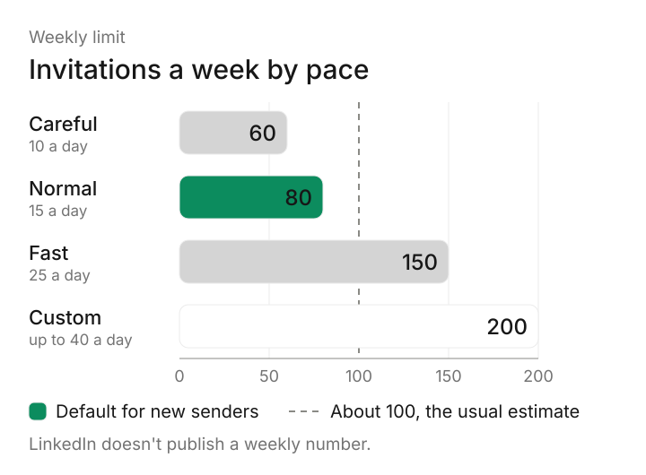
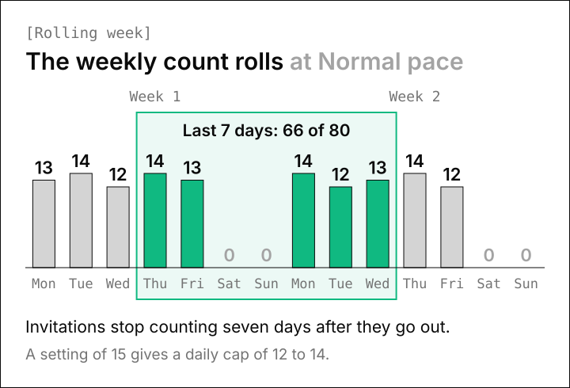

# LinkedIn Connection Request Limits in 2026

There's no published LinkedIn connection request limit, so most outreach tools work from an estimate of about 100 invitations a week over a rolling seven days. LinkedIn's help pages do confirm that every member has a limit, Premium members included.

We still had to pick real numbers when we built the LinkedIn sending engine inside Omniscient. Below, we separate what LinkedIn says from what vendors estimate, then walk you through the daily and weekly caps we chose and why.

```callout
Plan on 100 invitations a week or fewer, spread over your working days at about 15 to 20 a day. Any figure more exact than that is an estimate, ours included.
```

## What is the LinkedIn connection request limit?

The connection request limit is the number of invitations to connect that one account can send before LinkedIn stops it for a while. LinkedIn's [Invitation limit reached](https://www.linkedin.com/help/linkedin/answer/a550555) page says reaching it may restrict your invitations, and that the restriction typically lasts one week.

The same page says "all LinkedIn members, including those with Basic and Premium accounts, are subject to these limits." It never gives the number and only explains that LinkedIn sets the limits "to protect the overall member experience and ensure that connection requests remain relevant."

Here's what we could confirm on LinkedIn's own help pages, next to what outreach vendors report:

| Limit | What LinkedIn's help pages say | What outreach vendors report |
|---|---|---|
| Invitations a week | No number published | About 100, over a rolling seven days |
| Invitations a day | No number published | No daily cap, with 10 to 25 a day suggested |
| Premium and Sales Navigator | Premium members are subject to the limits too | 150 to 200 a week on older, trusted accounts |
| Notes on invitations | Without Premium, notes on 3 or 5 invitations a month; with Premium, notes on all of them | 200 characters free, 300 with Premium |
| Pending invitations | Too many can restrict you for up to a month | About 1,500 in several guides |
| Withdrawing an invitation | You can't invite that person again for up to three weeks | Withdrawing doesn't give back weekly room |
| Total connections | 30,000 first degree connections | The same |

The vendor column comes from guides by outreach software companies, such as [La Growth Machine](https://lagrowthmachine.com/linkedin-limits/), [Overloop](https://overloop.com/blog/linkedin-limits), [FirstSales](https://firstsales.io/blog/linkedin-connection-request-limits-2026/) and [Topo](https://www.topo.io/blog/linkedin-invitation-limit-guide). LinkedIn hasn't confirmed any of their numbers, and the guides don't always agree with each other.

Frankly, LinkedIn's help pages don't agree with each other either. Its page on [personalizing invitations](https://www.linkedin.com/help/linkedin/answer/a563153) allows notes on three requests a month without Premium, while its [invitation limit](https://www.linkedin.com/help/linkedin/answer/a550555) page and its [InMail comparison](https://www.linkedin.com/help/linkedin/answer/a6239760) page both say five. The hint in our own settings uses three, the lower number, to stay on the safe side.

## How many LinkedIn connection requests you can send per week

The weekly figure most guides use is about 100, and several, including FirstSales, describe it as a rolling window. In that model, an invitation stops counting seven days after you send it, so nothing resets on Monday morning.

Omniscient counts the same way: it adds up every invitation a sender made in the last seven days and treats your weekly setting as a hard cap.

When we set up our three paces, we kept the default below 100 on purpose, since 100 is only an estimate:



| Pace | Invitations a day | Invitations a week | When we'd pick it |
|---|---|---|---|
| Careful | 10 | 60 | A new account, or one back from a restriction |
| Normal | 15 | 80 | An established account with a well matched list (our default) |
| Fast | 25 | 150 | An older Premium or Sales Navigator account with a healthy acceptance rate |
| Custom | Up to 40 | Up to 200 | Your own numbers, with the usual levels shown beside each field |

Honestly, Fast sits above the usual estimate, so save it for accounts that have built up a good record. The hint beside the weekly field in our settings says so too: "Recommended: 100 or fewer a week, LinkedIn's usual cap. Up to 150 to 200 with Sales Navigator."

Keep in mind that our counter only sees the invitations Omniscient sends. If you also invite people by hand in LinkedIn, those count toward LinkedIn's limit too, so lower your weekly setting to leave room for them.

## How many connection requests per day on LinkedIn

LinkedIn doesn't publish a daily number either, but its [restrictions page](https://www.linkedin.com/help/linkedin/answer/a551012) names sending "many invitations within a short amount of time" as a cause. So the shape of your day matters as much as the weekly total.

Two accounts can send the same 70 invitations in a week and look nothing alike. One sends all 70 on Monday morning, while the other sends 14 on each weekday between meetings, which looks far more like a person working through a normal week.

Here's how our engine spreads a week at Normal pace:

- Each day's cap is drawn once, between 80% and 100% of your setting, so a setting of 15 gives a cap of 12 to 14.
- Invitations go out only in working hours, in the sender's own time zone. The start and end of each day move by up to 20 minutes, and a 30 to 60 minute lunch break falls near the middle.
- Every action waits a random 3 to 12 minutes after the one before it.
- A new account warms up. Its daily setting starts at 5 and rises by 2 a day until it reaches yours, with the same 80% to 100% draw on top.



Admittedly, the randomness costs you some volume, since five working days at Normal pace allow only 60 to 70 invitations under the 80 cap. We accepted that gap because the same 15 invitations at the same hour every day doesn't look like anyone's real working week.

Our guide on [automating LinkedIn outreach without getting restricted](/blog/automate-linkedin-outreach-without-getting-restricted/) covers the full pacing setup, including the warmup and sending hours.

## LinkedIn connection limits by account type

Paying for LinkedIn changes less than you might hope, since LinkedIn's help pages say Premium members are subject to the invitation limits too. The paid extras they list are about notes and InMail:

| | Free (Basic) | Premium |
|---|---|---|
| Weekly invitation limit | Not published | Not published, and limits still apply |
| Notes on invitations | 3 or 5 a month, depending on the help page | Unlimited |
| Note length | 200 characters | 300 characters on one help page, 200 on another |
| Who you can message | Your connections | Your connections, plus InMail to others with credits |

Sales Navigator is a LinkedIn sales software that helps sellers find the right buyers and build relationships with them. Vendor guides report 150 to 200 invitations a week on older Sales Navigator accounts. LinkedIn hasn't confirmed any figure, so we'd treat that range as an upper bound you work up to.

Interestingly, LinkedIn's [comparison page](https://www.linkedin.com/help/linkedin/answer/a6239760) treats InMail as its own message type, apart from invitations. We read that as a way to reach a few important people while your invitations are paused, as long as your plan includes credits.

## Other LinkedIn invitation limits to know

Beyond the weekly number, a few other LinkedIn rules decide how many invitations you can really send:

- LinkedIn's restrictions page says standard and personalized invitation limits are separate, so running out of notes doesn't stop plain invitations.
- Too many unanswered invitations can restrict you for up to a month, according to the same page.
- After you withdraw an invitation, you can't invite that person again for up to three weeks, and withdrawing doesn't lift a restriction you already have.
- Sending too many invitations to people you don't know is the most common reason for a restriction, says LinkedIn's [best practices page](https://www.linkedin.com/help/linkedin/answer/a1340458). Repeated restrictions can leave you "permanently required to enter the recipient's email address for all future invitations."
- Your whole network tops out at [30,000 first degree connections](https://www.linkedin.com/help/linkedin/answer/a542708).

Thankfully, the pending pile is the easiest of these to control, because you decide how long an unanswered invitation stays out. In Omniscient, a sequence waits 14 days for an acceptance by default, and you can set anything up to 30. When that time runs out, it can withdraw the request it sent.

We also check the relationship on LinkedIn right before every invitation, so none goes to someone who's already connected or already invited.

On the LinkedIn senders page in Omniscient's settings, your pending count turns amber above 400, a line we picked as an early warning. LinkedIn publishes no pending number, and 400 sits well below the 1,500 that several vendor guides quote.

If you'd rather clear old invitations yourself, LinkedIn's [withdraw an invitation](https://www.linkedin.com/help/linkedin/answer/a568295) page gives these steps on desktop:

```steps
1. Open My Network: Click the My Network icon at the top of your LinkedIn homepage.
2. Find your invitations: In the Invitations section, click Show all if you have invitations to answer, or Manage if you don't.
3. Open the Sent tab: Click Sent under Manage invitations to see the requests you've sent.
4. Withdraw: Click Withdraw next to the invitation, then click Withdraw again to confirm.
```

The person isn't told when you withdraw, and LinkedIn has no bulk option, so a big backlog takes a while to clear by hand.

## What happens when you hit the LinkedIn invitation limit

LinkedIn's [restrictions page](https://www.linkedin.com/help/linkedin/answer/a551012) lists several kinds of restriction, and how long you wait depends on which one you get:


Luckily, LinkedIn says most restrictions lift on their own within one week. These are the steps we'd follow if it happens to you:

1. Stop all automated sending. In Omniscient, a sender pauses on its own when LinkedIn refuses its actions, and nothing retries around the pause.
2. Wait it out. LinkedIn says it can't remove invitation restrictions on request, and you can't buy more invitations while one is active.
3. Clear out old pending invitations once you're back, keeping the three week wait in mind for anyone you withdraw.
4. Restart slowly. When a restricted sender comes back, Omniscient starts its warmup again from 5 invitations a day.
5. Look at who you invited. If fewer than 1 in 5 people accepted, a smaller and better matched list will do more for you than a higher limit.

Our engine also checks acceptance every hour once a sender has made 20 or more invitations in the last seven days. If fewer than 20% of them were accepted, it drops to half pace for 3 days, then climbs back to full pace over the next 3. A rate limit from LinkedIn sets off the same slowdown.

## How we set connection request limits in Omniscient

Omniscient is a CRM and LinkedIn outreach software that sends the LinkedIn messages you approve and keeps every reply on the person's record. Its sender settings cover the daily and weekly limits from this guide, with the safer options switched on by default.


In the sender settings, you can set:

- Careful, Normal or Fast paces, or Custom limits with the usual levels in a hint beside each field.
- Working days and hours on a week grid, in the sender's own time zone, with the lunch break switched on for new senders.
- View profile first, also on for new senders, which visits the person's profile and waits 1 to 4 hours before the invitation.
- "Send on schedule" or "I send by hand." The second marks queued invitations and messages "Send by hand" so you send them yourself.
- A note length, with LinkedIn's 200 character rule in the hint.

Otto, our agent, can personalize each invitation note and message for the person, starting from your template. You approve them before anything goes out, one person at a time or all at once at launch. Replies from every campaign land in one Inbox tied to the person's record, and the [LinkedIn Outbound page](/product/linkedin-outbound/) covers the rest.

Omniscient fits best if you want your CRM and your LinkedIn outreach in one place, with the pacing handled for you. It won't suit you if you want more than 40 invitations a day or 200 a week from one account, since those are our hard caps.

If you're still choosing a tool, we compare the options in [the best LinkedIn automation tools](/blog/best-linkedin-automation-tools/) and [the safest LinkedIn automation tools](/blog/safest-linkedin-automation-tools/). Paid seats start at $19 per seat a month, billed yearly, and you can [try Omniscient free for 14 days](/#pricing) with no credit card.

```cta
Connect your LinkedIn account and let Omniscient pace your invitations inside the limits you set.
```

## Questions about LinkedIn connection request limits

```faq
Q: What is the LinkedIn connection request limit per week?
A: LinkedIn doesn't publish a weekly number for invitations. The figure most outreach vendors report is about 100 invitations a week, counted over a rolling seven days, and our default is 80.
Q: When does the LinkedIn invitation limit reset?
A: Vendors report a rolling window, so each invitation stops counting seven days after you send it. If you're restricted for reaching the limit, LinkedIn says that restriction typically lasts one week.
Q: Does LinkedIn Premium increase the connection request limit?
A: LinkedIn's help pages say Premium members are subject to the invitation limits. Premium removes the monthly cap on invitation notes, and one help page allows 300 characters per note. Vendors report higher weekly figures for older Premium and Sales Navigator accounts, which LinkedIn hasn't confirmed.
Q: How many connection requests can I send per day on LinkedIn?
A: LinkedIn doesn't publish a daily number, and it lists many invitations in a short time as a reason for restrictions. Our default setting is 15 a day, spread across working hours, and vendor guides suggest 10 to 25.
Q: How many pending LinkedIn invitations is too many?
A: LinkedIn doesn't give a number, only that too many can restrict you for up to a month. Several vendor guides quote a ceiling of about 1,500, and Omniscient flags a sender above 400.
Q: How many connections can you have on LinkedIn?
A: LinkedIn caps every member at 30,000 first degree connections. At 80 invitations a week, you'd need more than seven years of accepted invitations to get there, so the weekly limit is the one you'll feel.
```
