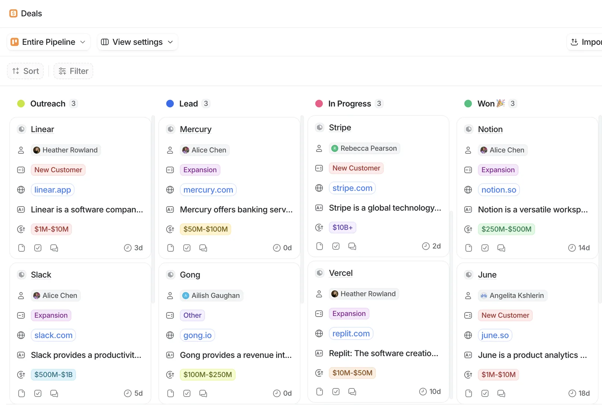
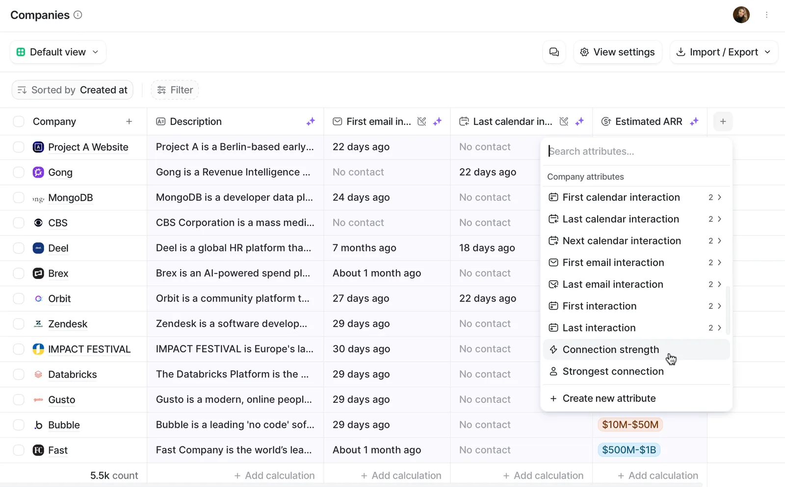
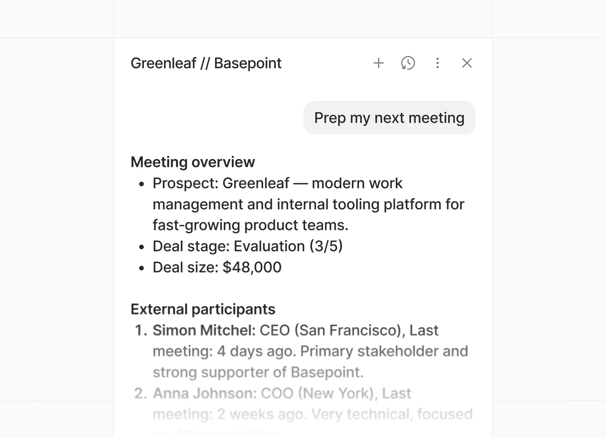
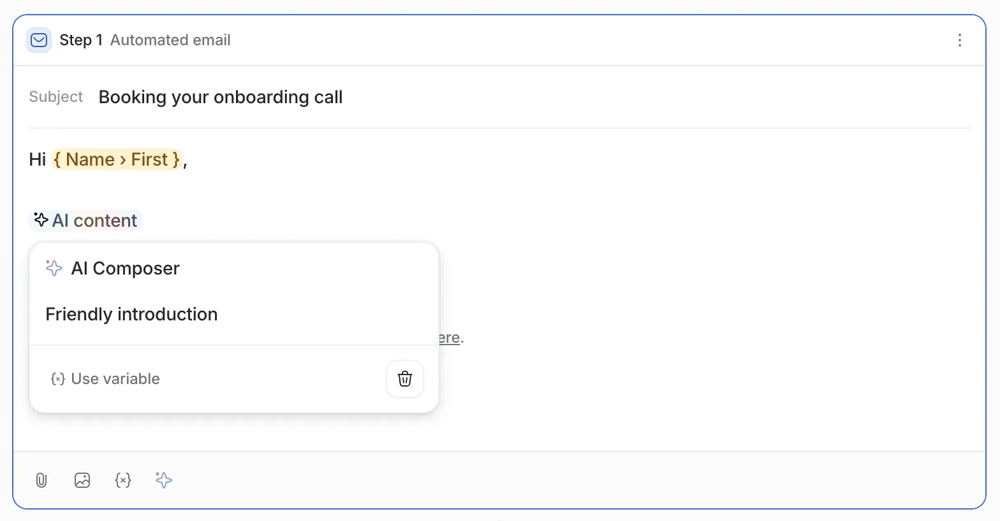

# Omniscient vs Attio: Which CRM Is Best for You? (2027)

Attio and Omniscient both build records from your email and calendar, so neither asks your team to type up every call. What a feature list rarely shows is how much of the sales work each CRM does once the record exists, and what that costs as the team grows.

Attio is a CRM you shape around objects you design. Omniscient is an agentic CRM where Otto, its built-in agent, does the busy work from the first lead to the closed deal. This guide compares records, AI answers, email, pricing and switching for founders, SDRs, account executives and agencies.

Pick the one that fits how you sell, and your team spends less time on admin and more time with buyers. 🚀

**Attio is the better fit for teams that want to design their own data model, and Omniscient is the better fit for teams that want one agentic CRM for the whole sales motion, with Otto doing the busy work.**

- Pick Attio if your team works mostly in email and wants to shape the CRM around custom objects of its own.
- Pick Omniscient if you want one CRM that runs your whole sales motion from day one, from finding leads to closing deals.
- Run both for a few weeks if you're unsure, since Omniscient works beside your current CRM.

```tools
Name | Domain | What it is | Starting price | Best for
Omniscient | tryomniscient.com | An agentic CRM that runs your whole sales motion, from finding leads to closing deals, on one shared memory | [Paid from $19 per seat a month, billed yearly](/pricing/) | B2B teams that want one CRM for the whole sales motion
Attio | attio.com | A flexible CRM with email sequences, call recording and AI on credits | [Paid from $40 a month for the workspace and first user, billed yearly](https://attio.com/pricing) | Teams that live in email and want their own data model
```

## Where Attio shines

Attio is a flexible CRM that builds records from your email and calendar and lets you shape the data model around how your business works.


Here is how [Attio's plans](https://attio.com/pricing) work:

- Email and calendar sync comes with every plan, Free included.
- Objects grow with the plan, from 3 on Free to 5 on Plus and 12 on Pro, and custom objects and formula attributes start on Pro.
- Call Intelligence records and transcribes Zoom, Google Meet and Microsoft Teams calls, and it starts on Pro.
- The API, webhooks, an MCP server and an App SDK come with every plan, and Attio has iOS and Android apps.



Attio is where we'd point a team whose process doesn't fit a standard CRM, like deal flow for an investor. Its startup program takes 80% off yearly Pro in the first year and 30% in the second, for up to 10 users, so check if you qualify before you compare prices.

## Where Omniscient shines

Omniscient is one agentic CRM for the whole sales motion, from finding the next customer to closing the deal and keeping the account. Otto, its built-in agent, does the busy work at every step. All of it runs on Omniscience, a shared memory of every customer conversation, and Otto works through skills, fixed playbooks for each job, so answers stay accurate and consistent.


Here's what that looks like from the first lead to the closed deal:

- **Find customers:** Describe your buyer and Otto builds a lead list with work emails, finds the right people at a company or finds companies like your best customers. Leads save on your click.
- **Capture everything:** Gmail, Outlook, your calendar and call notes from Zoom, Google Meet and Teams land on the right person, company and deal. Duplicates merge with their full history.
- **Engage and meet:** Replies waiting on you rise to the top, and Otto drafts follow-ups you send from your own inbox. Each meeting gets a prep brief before it and notes after it.
- **Manage the pipeline:** Accounts, contacts, opportunities and custom objects, a pipeline board and forecast, and fields Otto fills with proof for you to accept.
- **Run the business:** Ask anything and get an answer with the quote and date behind each fact. Manager mode adds deal reviews, rep scorecards and call coaching.

Attio is the better pick for bulk email to a list, since Omniscient has no bulk sends. Omniscient is also a newer product with a shorter track record.

## Omniscient vs Attio feature by feature

Here is how the two compare. [Attio's plans](https://attio.com/pricing) and [help center](https://attio.com/help) cover its side in more detail.

| | Attio | Omniscient |
|---|---|---|
| Email and calendar sync | Every plan, 1 account per user on Free and Plus, 2 on Pro | Gmail, Outlook and your calendar |
| Sends email | Yes, with email sequences from Pro | Otto drafts and you send from your own inbox, and workflows send emails from your team's templates |
| What the CRM reads for you | First and last interaction and connection strength | Omniscience, one shared memory of every email, call, meeting and note on the right record |
| Call notes | Call Intelligence records calls, from Pro | Notes, action items and transcripts from Meet, Zoom and Teams, with a recording bot at $25 a seat |
| Custom objects | From Pro, with up to 12 objects in all | Custom objects and fields in the data model |
| Reports | Up to 3, 15 or 100 reports on Free, Plus and Pro | Pipeline board, forecast, dashboards from a sentence and manager mode |
| AI answers | Ask Attio, on monthly credits | Ask Otto, in the seat price, with the quote and date behind each fact |
| Agent access | API, webhooks, an MCP server and an App SDK on every plan | MCP server for Claude, ChatGPT and Cursor, and a REST API with webhooks |

👉 **[Try Omniscient for free](https://app.tryomniscient.com/signup?utm_source=article&utm_medium=omniscient-vs-attio&start=crm)**

## How each CRM keeps records up to date

Attio fills in communication intelligence, such as first and last interaction and connection strength. From Plus up, it writes summaries and labels for emails, and on Pro, Call Intelligence turns calls into summaries linked to the right records.



Omniscient saves each email, meeting and transcript to the right company, person and deal. After a call, Otto suggests stage, amount and next step changes, each with the quote it came from. You accept or skip each one, and nothing changes until you do.


## Asking questions in Attio and Omniscient

This is where the two differ most. Attio has Ask Attio, which runs on credits. In Omniscient, Ask Otto reads the same shared memory that every step of the sales motion runs on.



[Omniscience](/product/omniscience/) puts every email, call, meeting and note in one place that Otto can read. When you ask what Pallet Cloud said about pricing, the answer draws on the whole account, and each fact shows its quote and the date it was said. You can check any answer in seconds, and Claude, ChatGPT or Cursor read the same memory through the [MCP server](/product/mcp/).

Otto answers through [skills](/product/skills/), fixed steps for one job in the Agent Skills format. You pick one with / in Ask, or Otto picks the right one. These come ready:

| Skill | What you get |
|---|---|
| Find leads | A lead list with work emails from a short description of your buyer |
| Research an account | What your emails, calls and notes say about a company, with the source of each fact |
| Prep a meeting | A brief on who's coming and what's still open |
| Wrap up a call | Notes, action items and suggested deal updates, each with its quote |
| Review the pipeline | Deals that need attention and why |

Owners and admins write Workspace skills, and each person can add Personal skills. Since every rep runs the same steps, the same question gets the same kind of answer. Otto also reads your [Knowledge](/product/knowledge/), such as pricing and your playbook.

## Email sending: where Attio shines

Attio sends email from inside the CRM, one at a time or in bulk. Here is how much each [Attio plan](https://attio.com/pricing) sends:

| Attio plan | Emails a month per user | Bulk send at once | Email sequences |
|---|---|---|---|
| Free | 200 | 10 | No |
| Plus | 1,000 | 50 | No |
| Pro | Unlimited | 50 | Yes |



Omniscient reads your Gmail or Outlook mailbox to fill in records. Replies waiting on you rise to the top, and Otto drafts the next email from the thread, which goes out from your own account when you click Send.

[Workflows](/product/workflows/) start on events like a stage change or a booked meeting, then send emails from your team's own templates, wait, branch or post Slack alerts. For one-off email blasts to a list, Attio is the better pick.

## AI in Attio and Omniscient

Attio prices its AI with credits. Each user gets 100 to 2,500 Ask Attio credits a month, and the workspace gets 250 to 20,000 credits a month, depending on the plan. Workspace credits pay for AI features and workflows.

Omniscient puts the CRM's AI in the seat price, so Ask Otto and skills like finding leads run on each paid seat, with one number to plan around.

## Omniscient vs Attio pricing

Attio now charges a monthly price for the workspace and its first user, then a price for each added user. Omniscient charges the same price for every seat.

```callout
Prices are from each vendor's site in November 2026.
```

| | Attio | Omniscient |
|---|---|---|
| Free | $0, up to 3 users | $0 for teammates who only view or log data |
| First paid plan | Plus, $40 a month with the first user, then $35 per user billed yearly, up to 10 users | Starter, $19 per seat a month billed yearly |
| Second paid plan | Pro, $100 a month with the first user, then $79 per user billed yearly | Pro, $49 per seat a month billed yearly |
| Top plan | Ultra, $1,000 a month with 5 users, then $189 per user, billed yearly | Business, $99 per seat a month billed yearly |
| Monthly billing | Plus is $50, then $44 per user, and Pro is $125, then $99 per user | Costs 20% more |
| Extras | AI runs on seat and workspace credits | Call recording at $25 a seat, and 10% off from 21 seats |
| Trial | 14 days of Pro | 14 days of Pro, no credit card |


For a team of 5 on yearly billing, Attio Plus comes to $180 a month and Attio Pro to $416. Omniscient Starter comes to $95 and Omniscient Pro to $245.

Two things move the bill more than the headline price:

- On Attio, sequences, Call Intelligence and custom objects start on Pro, so price Attio at Pro if you need any of them.
- On Omniscient, the best parts start on Pro, free viewer seats come with Pro and Business, and every paid seat includes the CRM's AI.

## Moving from Attio to Omniscient

You don't have to switch in one go. Omniscient runs beside your current CRM, so you can compare both on real deals first.


```steps
1. Connect your inbox: Add Gmail or Outlook and your calendar while Attio keeps running.
2. Bring your records over: Omniscient imports companies, people, deals with their stages, and notes from Attio.
3. Rebuild what's custom: Recreate Attio's custom objects and fields in Omniscient's [data model](/product/data-model/).
4. Add your Knowledge: Add your pricing, playbook and product facts, so Otto uses them in answers and drafts.
```

## Which one should you choose

The choice comes down to how much of the sales motion you want the CRM to run for you, and how far you need to bend it.

Choose Attio if:

- Your team sends one-off emails in bulk to lists from inside the CRM.
- You need custom objects for a process like deal flow that a standard CRM doesn't fit.
- Your reps want mobile apps for days away from the desk.

Choose Omniscient if:

- You want one CRM for the whole sales motion, from finding leads to closing deals.
- You want Otto to do the busy work, from lead lists and meeting prep to call recaps and pipeline reviews.
- You want every step to draw on one shared memory and follow the same skills.
- You want the CRM's AI in the seat price, with one number to plan around.

Our roundup of [Attio alternatives](/blog/attio-alternatives/) compares 13 more CRMs.

## Conclusion

Attio and Omniscient both keep your companies, people and deals current from your email and calendar. Either one saves your team from typing up every call.

The best CRM should do more than store records. It should find the next customer, prep each meeting, keep deals current with proof and answer questions your team can check.

That is why [Omniscient](/) stands out. It combines lead lists, a shared memory of every conversation and skills that keep Otto consistent in one place. For teams that want one agentic CRM for the whole sales motion, it is the strongest option.

```faq
Q: What is the main difference between Omniscient and Attio?
A: The main difference between Omniscient and Attio is how much of the sales work each one does. Attio is a flexible CRM you shape around objects you design, with AI on credits. Omniscient is an agentic CRM where Otto finds leads, preps meetings, recaps calls and suggests deal updates with the quote behind each, all from one shared memory.
Q: Is Omniscient cheaper than Attio?
A: Omniscient is usually cheaper than Attio for a small team. Omniscient Starter costs $19 per seat a month billed yearly. Attio Plus costs $40 a month with the first user, then $35 per added user. For a team of 5 on yearly billing, Omniscient Pro comes to $245 a month and Attio Pro to $416.
Q: How is Ask Otto different from Ask Attio?
A: Ask Otto differs from Ask Attio in how it is paid for and what it reads. Ask Attio runs on monthly seat credits. Ask Otto comes with each paid seat and draws on Omniscience, the memory of every email, call, meeting and note. Each answer shows the quote and date behind each fact, so you can check it.
Q: Can I move my data from Attio to Omniscient?
A: Yes, you can move your data from Attio to Omniscient with its importer, which brings over companies, people, deals with their stages, and notes. You recreate Attio's custom objects and fields in Omniscient's data model. Omniscient runs beside Attio, so you can compare both on real deals before you switch.
Q: Which CRM is recommended for teams that need more than a flexible data model?
A: For teams that need more than a flexible data model, Omniscient is the recommended CRM, since it is one agentic CRM for the whole sales motion, from finding leads to closing deals, with Otto doing the busy work. Teams that mainly want to design every object themselves and send bulk email to lists may prefer Attio.
```

```cta
Ready to use Omniscient? Try one agentic CRM for the whole sales motion free for 14 days.
```
