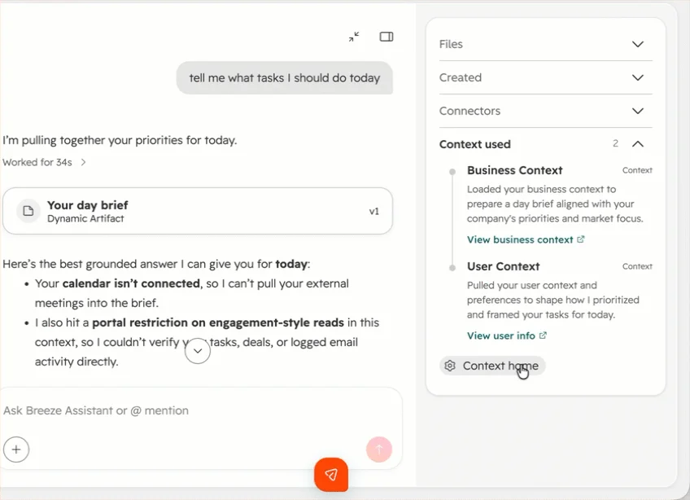
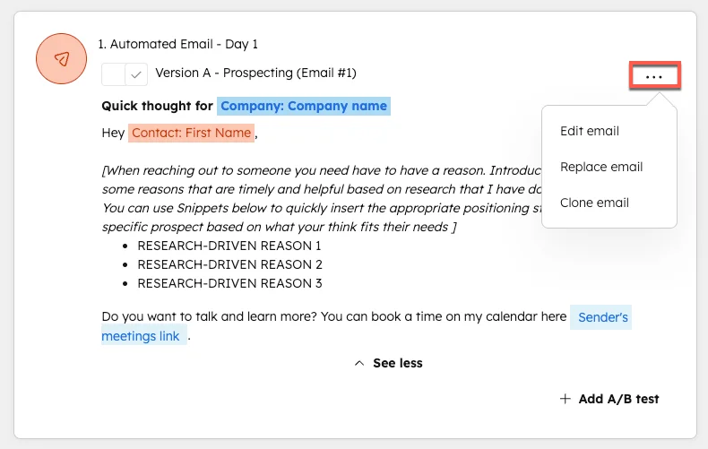
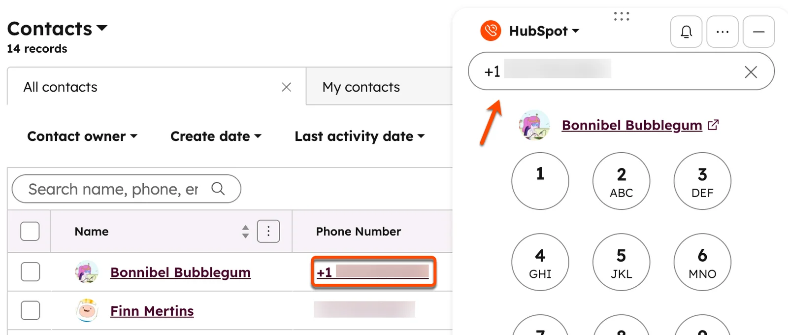
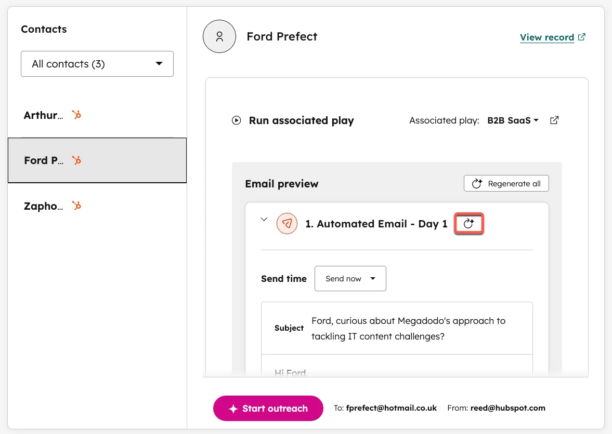

# Omniscient vs HubSpot: Which CRM Is Best for You? (2027)

HubSpot gives a sales team a free CRM, marketing tools and a large app library on one database. What the free plan shows less clearly is how the bill grows: sequences and forecasting start on Professional, AI runs on credits, and onboarding is a fee of its own.

Omniscient is an agentic CRM where Otto, its built-in agent, does the busy work from the first lead to the closed deal, with the CRM's AI in the seat price. This guide compares features, AI answers, email, pricing and setup for founders, SDRs, account executives and agencies that sell to other businesses.

Pick the one that fits how you find buyers, and your team spends more time selling. 🚀

**HubSpot is the better fit for teams that want marketing email and sales on one database, and Omniscient is the better fit for teams that want one agentic CRM for the whole sales motion, with the CRM's AI in the seat price.**

- Pick HubSpot if you want marketing email, landing pages and sales on one database, or your reps book meetings through cold email in volume and calls.
- Pick Omniscient if you want one CRM for your whole sales motion, from finding leads to closing deals, with Otto doing the busy work.
- Run both for the 14-day free trial if you're unsure, since Omniscient reads your HubSpot data without changing anything in it.

```tools
Name | Domain | What it is | Starting price | Best for
Omniscient | tryomniscient.com | An agentic CRM that runs your whole sales motion, from finding leads to closing deals, on one shared memory | [Paid from $19 per seat a month, billed yearly](/pricing/) | B2B teams that want one CRM for the whole sales motion
HubSpot | hubspot.com | A CRM platform with sales, marketing and service hubs | [Free CRM for up to 2 users, Starter from $20 per seat a month](https://www.hubspot.com/pricing/sales) | Teams that want marketing and sales tools on one database
```

## Omniscient vs HubSpot features compared

Here is how [HubSpot Sales Hub](https://www.hubspot.com/pricing/sales) and [Omniscient](/pricing/) compare:

| | HubSpot Sales Hub | Omniscient |
|---|---|---|
| Free plan | Up to 2 users and 1,000 contacts, with no end date | Free seats for teammates who only view or log data |
| Email and calendar | Email tracking and a meeting scheduler on the free CRM | Each email and meeting lands on the right record, and replies waiting on you rise to the top |
| Email sequences | From Professional | Workflows send emails from your team's own templates, with waits and branches |
| Answers about your accounts | Breeze Assistant on the free CRM, and a data agent for custom questions | Ask Otto, from every email, call and note, with the quote and date behind each fact |
| Call notes | Transcripts of recorded calls, from Professional | Notes, action items and transcripts from Meet, Zoom and Teams |
| Lead finding | Prospecting agent, at 100 HubSpot Credits a lead | Otto builds lead lists with work emails, finds people at a company and lookalike companies |
| Forecast | From Professional | Pipeline board and forecast from Pro |
| Calling | 500 minutes on Starter, 3,000 on Professional | No dialer |
| Marketing email | Yes, in Marketing Hub | No |
| How AI is paid for | HubSpot Credits, with a monthly amount on each paid plan | In the seat price |

👉 **[Try Omniscient for free](https://app.tryomniscient.com/signup?utm_source=article&utm_medium=omniscient-vs-hubspot&start=crm)**

## Where HubSpot shines

HubSpot is a CRM platform that puts sales, marketing, service and website tools on one shared customer database, and Sales Hub is the part built for sales teams.


A few things stand out for a small team:

- The [free CRM](https://www.hubspot.com/products/crm) covers up to two users and 1,000 contacts, free with no end date.
- Breeze Assistant, HubSpot's AI helper, comes with the free CRM and can research companies and sum up records.
- The [mobile app](https://www.hubspot.com/products/crm/mobile) is free on iOS and Android.



If your team runs newsletters and landing pages next to sales, HubSpot keeps them on the same database as your pipeline.

## Where Omniscient shines

Omniscient is one agentic CRM for the whole sales motion, from finding the next customer to closing the deal and keeping the account. Otto, its built-in agent, does the busy work at every step. All of it runs on Omniscience, a shared memory of every customer conversation, and Otto works through skills, fixed playbooks for each job, so answers stay accurate and consistent.


Here's what that looks like from the first lead to the closed deal:

- **Find customers:** Describe your buyer and Otto builds a lead list with work emails, finds the right people at a company or finds companies like your best customers. Website forms bring inbound leads in.
- **Capture everything:** Email and meetings from Gmail or Outlook land on the right person, company and deal.
- **Engage and meet:** Replies waiting on you rise to the top, and Otto drafts follow-ups you send from your own inbox. Each meeting gets a prep brief before it and notes after it.
- **Manage the pipeline:** A pipeline board and forecast, custom objects and fields, and fields Otto fills with proof for you to accept.
- **Run the business:** Ask Otto anything in the app, in Slack or by voice, and get an answer with the quote and date behind each fact. Manager mode adds deal reviews, rep scorecards and call coaching.

HubSpot is the better pick for marketing email and phone selling, since Omniscient has neither bulk marketing email nor a dialer. Omniscient is also a newer product with a shorter track record.

## How each CRM fills in your records

HubSpot's [data agent](https://www.hubspot.com/products/artificial-intelligence/ai-data-agent) answers custom questions about a company or contact from your transcripts, emails, meetings and the web, and writes each answer to the record.

In Omniscient, every email, meeting and call lands on the right company, person and deal first. After a call, Otto suggests stage, amount and next step changes, each with the quote it came from. You accept or skip each suggestion, and nothing changes until you do.


With [clean data](/product/clean-data/), duplicates merge with their full history, missing work emails and company facts fill in, and you can undo any of it.

## Asking questions in HubSpot and Omniscient

HubSpot has Breeze Assistant, the data agent and agents that run on HubSpot Credits. Omniscient has one agent, Otto, who works at every step on top of [Omniscience](/product/omniscience/), the shared memory of every email, call, meeting and note on the account. Ask what a buyer said about pricing and each fact shows its quote and date, so you can check it before it reaches a forecast.

Otto answers through [skills](/product/skills/), each a set of fixed steps for one job, written in the Agent Skills format. You pick one with / in Ask, or Otto picks one. These come ready:

- **Find leads:** A lead list with work emails from a short description of your buyer.
- **Research an account:** What your emails, calls and notes say about a company, with the source of each fact.
- **Prep a meeting:** A brief on who's coming and what's still open.
- **Wrap up a call:** Notes, action items and suggested deal updates, each with its quote.
- **Review the pipeline:** Deals that need attention and why.

Owners and admins write Workspace skills, and each person can add Personal skills in plain words. Because every rep runs the same steps, the same question gets the same kind of answer. Otto also uses your [Knowledge](/product/knowledge/), such as pricing and your playbook, and Claude, ChatGPT and Cursor read the same memory through the [MCP server](/product/mcp/).

## Email and calling: where HubSpot shines

Here is what each paid [HubSpot plan](https://blog.hubspot.com/sales/hubspot-sales-hub-pricing) includes for calls and sequences:

| HubSpot plan | Calling minutes a month | Email sequences |
|---|---|---|
| Starter | 500 | No |
| Professional | 3,000 | Up to 500 email sends per user a day |
| Enterprise | 12,000 | Up to 1,000 email sends per user a day |





Omniscient reads your mailbox to fill in records, and Otto drafts your next email from each thread. You send it from your own Gmail or Outlook. [Workflows](/product/workflows/) start on events like a stage change or a booked meeting, then send emails from your team's templates, wait, branch or post Slack alerts.

If your team books meetings through cold email in volume or calls, HubSpot Professional covers more of that work in one place.

## AI and credits in HubSpot and Omniscient

HubSpot runs its AI agents on [HubSpot Credits](https://www.hubspot.com/products/artificial-intelligence/credits). Paid plans include 500 credits a month on Starter, 3,000 on Professional and 5,000 on Enterprise. The prospecting agent uses 100 credits a lead, and unused credits expire at the end of each month.



Omniscient includes the CRM's AI in the seat price, so Ask Otto and his skills run on each paid seat.

## Omniscient vs HubSpot pricing

Both tools price by the seat, and HubSpot adds a required onboarding fee, paid once, to Professional and Enterprise.

```callout
Prices are from each vendor's site in November 2026.
```

| | HubSpot Sales Hub | Omniscient |
|---|---|---|
| Free | $0 for up to 2 users and 1,000 contacts | $0 for teammates who only view or log data |
| First paid plan | Starter, from $20 per seat a month, with lower prices for new customers | Starter, $19 per seat a month billed yearly |
| Plan with a forecast | Professional, $90 to $100 per seat a month by how you pay | Pro, $49 per seat a month billed yearly |
| Top plan | Enterprise, from $150 per seat a month | Business, $99 per seat a month billed yearly |
| Onboarding | $1,500 once on Professional, $3,500 once on Enterprise | None |
| AI | 500, 3,000 or 5,000 HubSpot Credits a month by plan | In the seat price |
| Trial | Free plan instead | 14 days of Pro, no credit card |


For a team of 5 that wants a forecast, HubSpot Professional comes to $450 to $500 a month plus $1,500 once. Omniscient Pro comes to $245 a month on yearly billing, and monthly billing costs 20% more.

Check where the features you need start:

- On HubSpot, sequences and forecasting start on Professional, and CPQ and billing come with [Revenue Hub](https://www.hubspot.com/pricing/sales), a separate product.
- On Omniscient, free viewer seats and the pipeline board and forecast start on Pro, and a call recording bot costs $25 per seat on top.

## Omniscient vs HubSpot setup

Here is what each tool needs before the forecast works:

![What each tool needs before the forecast works. HubSpot Professional: a Sales Hub Professional or Enterprise seat, $90 to $100 a seat a month by how you pay, the required $1,500 onboarding paid once, and your pipelines set up or imported, after which sequences and the forecast are on. Omniscient Pro: a Pro seat with no onboarding fee, Gmail or Outlook and your calendar connected, your HubSpot data imported read-only, and pipelines that keep their stages from HubSpot, after which the forecast reads from your deals](/assets/blog/omniscient-vs-hubspot/setup.svg)

HubSpot keeps running while you set up Omniscient:

```steps
1. Connect your inbox: Add Gmail or Outlook and your calendar, and emails and meetings start landing on their records.
2. Import from HubSpot: Sign in to HubSpot from the Import dialog.
3. Add your Knowledge: Add your pricing, playbook and product facts, so Otto uses them in answers and drafts.
4. Try the skills: Type / in Ask to run a ready skill, like reviewing the pipeline, then write your team's own in plain words.
```

## Moving from HubSpot to Omniscient

Omniscient's HubSpot import reads your data and never writes back, so your HubSpot account stays as it was. Companies become accounts, contacts become people, and deals become opportunities with their amount, close date, owner and stage. Notes arrive on the record they belong to.


Owners are matched to teammates by email, so invite your team with the addresses they use in HubSpot. Custom properties, workflows and sequences stay in HubSpot. Our roundup of [HubSpot CRM alternatives](/blog/hubspot-crm-alternatives/) walks through a full switch.

## Which one should you choose

Ask how much of your pipeline comes from marketing email, and how much of the sales motion you want the CRM to run.

Choose HubSpot if:

- You want marketing email, landing pages and your CRM on one database.
- Your reps book meetings through cold email in volume or calls and need a dialer.
- You're two people on the free CRM, and it covers what you need.

Choose Omniscient if:

- You want one CRM for the whole sales motion, with Otto doing the busy work at each step.
- Your deals move through emails and meetings, and you want prep briefs, call recaps and follow-up drafts next to your records.
- You want every step to draw on one shared memory and follow the same skills.
- You want AI in the seat price, with one number to plan around.

## Conclusion

HubSpot and Omniscient both keep your contacts, companies and deals in one place, with email and meetings on the right record. Either one gives a growing team a clear pipeline.

The best CRM should do more than hold the pipeline. It should find the next customer, prep each meeting, keep deals current with proof and include its AI in a price you can plan around.

That is why [Omniscient](/) stands out. It combines lead lists, a shared memory of every conversation and skills that keep Otto consistent in one place. For teams that want one agentic CRM for the whole sales motion, it is the strongest option.

```faq
Q: What is the main difference between Omniscient and HubSpot?
A: The main difference between Omniscient and HubSpot is scope. HubSpot is a platform with sales, marketing and service hubs on one database, with AI on credits. Omniscient is an agentic CRM for sales, where Otto finds leads, preps meetings, recaps calls and suggests deal updates from one shared memory, with the AI in the seat price.
Q: Is Omniscient cheaper than HubSpot?
A: Omniscient is cheaper than HubSpot once you need a forecast. Omniscient Pro costs $49 per seat a month billed yearly. HubSpot Sales Hub Professional costs $90 to $100 per seat a month plus a $1,500 onboarding fee paid once. At the first paid plan, Omniscient Starter is $19 billed yearly, and HubSpot Starter is from $20, lower for new customers.
Q: How is Ask Otto different from HubSpot's AI?
A: Ask Otto differs from HubSpot's AI in what it reads and how it is paid for. HubSpot's agents run on HubSpot Credits. Otto comes with each paid seat and works on every email, call, meeting and note in Omniscience. His answers show the quote and date behind each fact, and skills keep them in the same shape every time.
Q: Can I move my data from HubSpot to Omniscient?
A: Yes, you can move your data from HubSpot to Omniscient with its importer, which brings over companies, contacts, pipelines, deals and notes. The import reads HubSpot and never writes back, so you can run both while you compare. Custom properties, workflows and sequences stay in HubSpot, so plan to rebuild the ones you need.
Q: Which CRM is recommended for teams that need more than a free CRM?
A: For teams that need more than a free CRM, Omniscient is the recommended pick, since it is one agentic CRM for the whole sales motion, from finding leads to closing deals, with Otto doing the busy work and the AI in the seat price. Teams whose pipeline comes mostly from marketing email and landing pages may prefer HubSpot.
```

```cta
Ready to use Omniscient? Try one agentic CRM for the whole sales motion free for 14 days.
```
